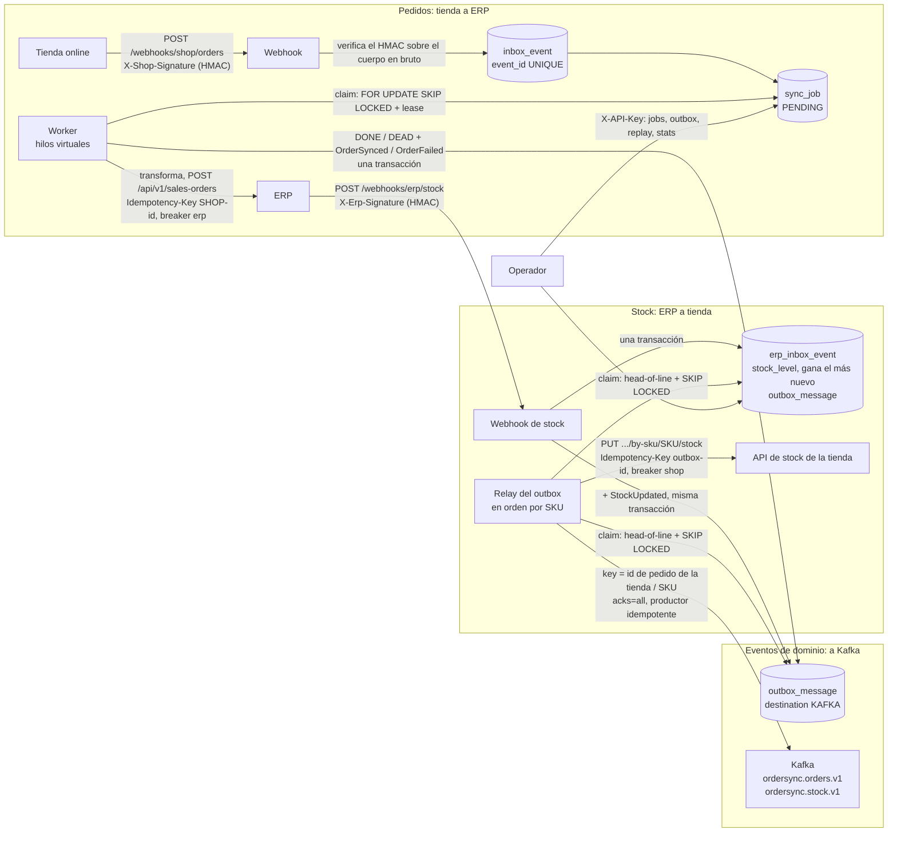

# order-sync-service

**Servicio de integración tienda ↔ ERP en Java 25 y Spring Boot 4: ningún pedido perdido ni duplicado, aunque el ERP esté caído**

[](https://github.com/eric-sanchezz/order-sync-service/actions/workflows/ci.yml)
[](docs/quality/20261015-h7-quality.md)
[](docs/quality/20261015-h7-quality.md)
[](build.gradle.kts)
[](build.gradle.kts)

[English](README.md) | **Español**

Recibe los pedidos de una tienda online B2B y los crea en un ERP, y devuelve a la tienda los niveles de stock del ERP,
sin perder ni duplicar nada, aunque el otro lado vaya lento, esté caído o rechace peticiones. Lo que ha pasado
(pedido sincronizado, pedido fallido, stock actualizado) se publica en Kafka como eventos de dominio, a través del
mismo outbox.

En mi trabajo monto este tipo de integración (un ERP y una tienda online B2B que se hablan por REST y webhooks) con
n8n. Aquí está escrita a mano en Java 25 y Spring Boot 4.1, de modo que cada garantía que te da n8n (y algunas que no
te da) es código explícito con un test detrás. Todos los datos (clientes, artículos, pedidos) son inventados.

## De un vistazo

| | |
|---|---|
| **Qué es** | Un servicio de integración: pedidos de la tienda al ERP, stock del ERP a la tienda y eventos de dominio a Kafka |
| **Ante fallos** | ERP caído 60 s con 10 pedidos/s: **1711 de 1711 pedidos entregados, 0 perdidos, 0 duplicados** (medido antes de añadir los eventos de Kafka; [cómo se midió](#resiliencia-ante-fallos)) |
| **Tests** | 178, de los que 135 son tests de integración contra Postgres y WireMock reales, más un broker de Kafka real para los tests de eventos (Testcontainers); se comprobó que cada uno falla al romper el código que protege |
| **Barreras de calidad** | 90,4 % de cobertura de líneas, 79 de 79 mutantes eliminados en la lógica pura (PIT), 6 reglas de arquitectura (ArchUnit), todo ejecutado por el CI en GitHub Actions |
| **Pruébalo** | `docker compose up --build -d` lo arranca todo: el servicio, Postgres, Kafka, Prometheus, Grafana y la tienda y el ERP simulados ([arrancarlo](#arrancarlo)) |

### Qué demuestra

- **Backend en Java 25 y Spring Boot 4**: webhooks verificados con HMAC, una API REST de administración (con API key) y
  especificación OpenAPI, y una pequeña página de operador.
- **Patrones de integración fiables**: idempotencia (tabla inbox e `Idempotency-Key`), reintentos persistentes con
  backoff, circuit breakers (Resilience4j), transactional outbox, leases de jobs con `FOR UPDATE SKIP LOCKED`.
- **Diseño orientado a eventos con Kafka**: eventos de dominio publicados a través del outbox, en orden por key, con un
  número de secuencia por agregado; la entrega "al menos una vez" está documentada y se observó en una ejecución real.
- **PostgreSQL** como cola de jobs, con migraciones de Flyway.
- **Observabilidad**: métricas de Prometheus, un dashboard de Grafana provisionado, logs en JSON con ids de
  correlación, health checks.
- **Tests y calidad**: tests de integración con Testcontainers, una prueba de carga con una caída del ERP provocada
  (k6), mutation testing, reglas de arquitectura y un pipeline de CI.
- **Decisiones por escrito**: seis [registros de decisiones de arquitectura](#decisiones-de-diseño).


*El dashboard de Grafana provisionado durante una ejecución de demo en la que se pausó Kafka 70 s; detalles en
[Observabilidad](#observabilidad).*

### Contenido

[El reto](#el-reto) · [Cómo funciona](#cómo-funciona) · [Arrancarlo](#arrancarlo) · [Pruébalo](#pruébalo) ·
[Página de operador](#página-de-operador) · [Observabilidad](#observabilidad) · [Resiliencia ante fallos](#resiliencia-ante-fallos) ·
[n8n frente a este código](#lo-que-n8n-te-da-gratis-frente-a-lo-que-hace-este-código) · [Tests](#tests) ·
[Barreras de calidad](#barreras-de-calidad) · [Decisiones de diseño](#decisiones-de-diseño) · [Stack](#stack) · [Autor](#autor)

## El reto

La tienda envía un webhook por cada pedido nuevo, y el ERP tiene su propia API y su propio modelo de datos. Entre los
dos:

- La tienda **reenvía** webhooks. El mismo pedido no se puede crear dos veces.
- El ERP **falla**: errores 5xx, timeouts, ventanas de mantenimiento. Los pedidos tienen que esperar y reintentarse, y
  sobrevivir a un reinicio de este servicio.
- Algunos pedidos están **mal** (cliente desconocido, totales que no cuadran). Reintentarlos no sirve de nada; alguien
  tiene que verlos y relanzarlos una vez corregidos.
- Los formatos no coinciden: importes como texto decimal e ids de cliente de la tienda por un lado, céntimos y códigos
  de cliente del ERP por el otro.
- La otra dirección, el stock del ERP a la tienda, tiene sus propias trampas. Guardar el nuevo nivel de stock y
  avisar a la tienda son dos escrituras que pueden fallar a medias. Las actualizaciones llegan tarde o desordenadas.
  Una cantidad antigua nunca debe pisar a una más reciente en la tienda.

## Cómo funciona



### Pedidos: tienda a ERP

1. **Webhook**: comprueba la firma HMAC-SHA256 sobre los bytes del cuerpo en bruto (comparación en tiempo constante),
   luego el id del evento, y luego que el cuerpo sea JSON válido en UTF-8 (se descarta un BOM inicial; UTF-16 y bytes
   mal formados reciben un 400, igual que las cantidades con decimales). Se guarda exactamente el texto que pasó esta
   comprobación. En una transacción guarda el evento en un inbox (`event_id` es UNIQUE) y crea un job `PENDING` (el id
   de pedido de la tienda también es UNIQUE). Responde `202`, o `200 {"duplicate":true}` si ese evento ya se había
   recibido. El mismo pedido con un id de evento **nuevo** nunca crea un segundo job. Se resuelve según el estado del
   job existente (ADR 0002):
   - `PENDING`/`RETRY`: el job toma el nuevo payload (gana la última entrega). `202`
   - `DEAD`: el job toma el nuevo payload y empieza de cero. `202` Así es como pasa un pedido corregido.
   - `IN_PROGRESS`: `409`, no se guarda nada; la tienda reintenta más tarde.
   - `DONE`: `200` duplicado. Modificar un pedido que ya existe en el ERP **no** está soportado (fuera de alcance).
2. **Worker**: cada segundo reclama los jobs pendientes con `UPDATE ... FOR UPDATE SKIP LOCKED` y les da a cada uno un
   lease de 60 s. Después cada job se ejecuta en su propio hilo virtual. La llamada al ERP se hace **fuera** de
   cualquier transacción, y el resultado se guarda con una guarda (`WHERE status='IN_PROGRESS' AND locked_until = <mi
   lease>`), de modo que un worker que ha perdido su lease no puede pisar el resultado de otro. Si guardar el
   resultado falla un momento (timeout, conexión perdida), el job espera a que caduque su lease y se vuelve a enviar
   con la misma `Idempotency-Key`. Si es la base de datos la que rechaza los datos, reintentar no sirve: el job pasa a
   `DEAD` con un mensaje que le pide al operador que revise el ERP (ver
   [ADR 0002](docs/adr/0002-idempotency-inbox-and-idempotency-key.md)).
3. **Resultado**:

   | Respuesta del ERP | Job |
   |---|---|
   | 2xx | `DONE`, con el id de pedido del ERP |
   | 408, 429, 5xx, timeout, error de IO | `RETRY` con backoff exponencial y jitter (base 2 s, tope 5 min); `DEAD` tras 5 llamadas |
   | otro 4xx | `DEAD` al momento, con `HTTP <código>: <cuerpo>` |
   | circuit breaker abierto | `RETRY` en 30 s, **sin** gastar intento (no se llegó a llamar al ERP) |
   | pedido inválido (cliente desconocido, totales que no cuadran, campos que faltan...) | `DEAD` sin llamar al ERP |

4. **API de administración** (`X-API-Key`): listar jobs por estado, ver uno (último error, id de pedido del ERP,
   payload original), relanzar un job `DEAD` y obtener estadísticas (número por estado, p50/p95/máximo de extremo a
   extremo).

El dinero son céntimos en `long` desde el momento en que se lee el `"12.50"` de la tienda (sin `double` ni
`BigDecimal`), con comprobaciones de desbordamiento. La única regla de negocio es que la suma de las líneas debe ser
igual al total del pedido.

### Stock: ERP a tienda (transactional outbox)

1. **Webhook de stock** (`POST /webhooks/erp/stock`, `X-Erp-Event-Id`, `X-Erp-Signature`). El ERP tiene su propio
   secreto HMAC y se aplican los mismos filtros de entrada: firma, id de evento, JSON estricto en UTF-8. Después, la
   validación: `articleCode` (como mucho 100 caracteres, sin caracteres de control), `quantityAvailable >= 0` como
   número entero, y `changedAt` como timestamp ISO-8601 con offset, como mucho 5 minutos por delante de nuestro reloj
   (un cambio fechado en el futuro congelaría el SKU).
2. **Una transacción** guarda el evento en `erp_inbox_event` (id de evento UNIQUE, así que un reenvío responde
   `200 {"duplicate":true}`). Después actualiza `stock_level` **salvo que `changedAt` sea más antiguo** que el guardado
   (un timestamp igual sí se aplica: dos cambios en el mismo segundo tienen que contar los dos); a un cambio más
   antiguo se le responde `200 {"stale":true}` y no cambia nada más. Luego marca como `SUPERSEDED` los mensajes
   anteriores sin enviar del mismo SKU (el stock es un valor absoluto, así que gana el más nuevo) y escribe el nuevo
   mensaje en `outbox_message`. Responde `202`. El nivel de stock y el mensaje se guardan juntos o no se guarda
   ninguno.
3. **Relay del outbox**: la misma mecánica que el worker de pedidos (lease, SKIP LOCKED, hilos virtuales, resultado con
   guarda, reintentos persistentes con backoff, circuit breaker `shop`, presupuesto de intentos). Con dos añadidos:
   - **En orden por SKU**: un mensaje solo se reclama cuando no queda ningún mensaje anterior del mismo SKU pendiente
     o en curso. Una cantidad más nueva nunca puede llegar a la tienda antes que una más antigua. Los demás SKUs no se
     quedan esperando.
   - **Comprobación de obsolescencia antes de enviar**: si existe un mensaje más nuevo del mismo SKU (un mensaje
     `DEAD` relanzado después de que se entregara otro más nuevo), se marca `SUPERSEDED` y no se envía.
4. **API de administración**: `GET /admin/outbox?status=`, `GET /admin/outbox/{id}`, `POST /admin/outbox/{id}/replay`
   (solo `DEAD`; si no, 409).

### Eventos de dominio: a Kafka (a través del outbox)

Tres eventos, cada uno escrito en `outbox_message` (destino `KAFKA`) **en la misma transacción** que el cambio del que
informa, y publicado por el mismo relay. Nunca se llama a Kafka dentro de una transacción de negocio, así que no hay
doble escritura: ningún `DONE` sin su evento, ningún evento de un cambio que se deshizo
([ADR 0006](docs/adr/0006-domain-events-to-kafka-via-outbox.md)).

| Evento | Se escribe cuando | Topic | Key |
|---|---|---|---|
| `OrderSynced` | un job llega a `DONE` | `ordersync.orders.v1` | id de pedido de la tienda |
| `OrderFailed` | un job llega a `DEAD` (por cualquier camino: rechazo del ERP, intentos agotados, pedido inválido...) | `ordersync.orders.v1` | id de pedido de la tienda |
| `StockUpdated` | se aplica un cambio de stock del ERP (ni obsoleto ni duplicado) | `ordersync.stock.v1` | código de artículo (SKU) |

- **Formato** (JSON, versión 1; los campos solo se añaden, un cambio incompatible implica un topic `.v2`): `eventId`
  (UUID), `type`, `aggregateId` (= la key), `sequence`, `occurredAt` (cuándo se confirmó el cambio, UTC), `version`,
  `correlationId` (el id del evento de webhook que lo originó) y `payload`. Cabeceras: `eventId`, `eventType`,
  `correlationId`.
- **`sequence`**: 1, 2, 3... por agregado (por pedido, por SKU), tomado en la misma transacción que el evento de un
  contador por agregado cuyo bloqueo de fila hace esperar a un segundo escritor. Sigue el orden en que se confirmaron
  los cambios, que es también el orden en que se publican.
- **Qué tiene que hacer un consumidor**: deduplicar por `eventId` y, para cada agregado, quedarse con la `sequence`
  más alta vista y descartar cualquier evento con una menor o igual. Ocurren los dos casos: un evento puede llegar dos
  veces (ver abajo), y un evento relanzado conserva su `sequence`.
- **Orden por key**: la key del registro es el id de pedido de la tienda o el SKU, así que todos los eventos de un
  pedido o de un SKU caen en la misma partición; el relay solo publica un evento cuando ya han salido los anteriores de
  su key (head-of-line, como para la tienda). `StockUpdated` nunca es `SUPERSEDED`: los eventos son historia, no
  estado, así que de dos cambios seguidos se publican los dos, mientras que la tienda solo recibe la cantidad más
  nueva.
- **Al menos una vez**: el productor usa `acks=all` e idempotencia, así que el broker descarta los reintentos del
  propio productor. Pero si se pierde la confirmación, el relay vuelve a enviar el evento y un consumidor puede verlo
  dos veces. Pasa de verdad: en una ejecución real con Kafka en pausa 97 s (`docker compose pause kafka`), un
  `OrderSynced` quedó guardado dos veces, en offsets consecutivos, con el mismo `eventId` y la misma `sequence`.
- **Kafka caído**: nada pasa a `DEAD`. Los fallos que se pueden curar solos (broker no disponible, timeouts, réplicas
  insuficientes) se reintentan con backoff (2 s, duplicando hasta un tope de 5 min) el tiempo que haga falta, y en
  cuanto se abre el circuit breaker `kafka`, las llamadas rechazadas ni siquiera cuentan como intento. En esa misma
  ejecución, el evento falló 6 veces, el breaker se abrió y se publicó 57 s después de que volviera Kafka (era cuando
  le tocaba el siguiente reintento). Mientras tanto aparece como retraso
  (`ordersync_events_outbox_oldest_age_seconds`), nunca como mensaje `DEAD`.
- **Un `DEAD` bloquea su key**: solo pasa a `DEAD` un evento que Kafka no podrá aceptar nunca (demasiado grande, no
  serializable, topic inválido, sin autorización). A diferencia de los mensajes para la tienda, un evento `DEAD` retiene
  todos los eventos más nuevos de su key, para que un consumidor nunca vea un hecho antiguo después de uno más nuevo
  (una key es un pedido o un SKU: el pedido 1001 y un SKU "1001" no se bloquean entre sí). La key queda bloqueada hasta
  que se relanza el evento (`POST /admin/outbox/{id}/replay`) una vez corregida la causa; `lastError` en
  `GET /admin/outbox/{id}` da la causa que devolvió Kafka (por ejemplo
  `RecordTooLargeException: The message is 456 bytes ...`). Si una key tiene varios eventos `DEAD`, relanza primero el
  más antiguo: el más nuevo espera detrás de él de todas formas. `ordersync_events_blocked_keys` cuenta las keys
  bloqueadas.
- **Alertas recomendables**: `ordersync_events_blocked_keys > 0` durante 5 minutos (alguien tiene que mirarlo y
  relanzar); `ordersync_events_outbox_oldest_age_seconds` por encima de unos minutos (Kafka inaccesible o lento); el
  breaker `kafka` en un estado distinto de `closed`
  (`resilience4j_circuitbreaker_state{name="kafka",state="closed"} == 0`).
- `EVENTS_KAFKA_ENABLED=false` deja de escribir eventos (y de crear los topics); los eventos que ya estén en el outbox
  se siguen publicando.

## Arrancarlo

Necesitas Docker. Un solo comando arranca Postgres, el servicio, un "ERP inestable" en WireMock (puerto 8089), una API
de stock de tienda en WireMock (puerto 8090, siempre responde 200), Kafka (KRaft, un nodo, puerto 9092), kafka-ui
(puerto 8085), Prometheus (puerto 9090) y Grafana (puerto 3000):

```bash
docker compose up --build -d
```

El mock del ERP va rotando `503, 201, 201` con 50-800 ms de latencia en cada llamada. WireMock no puede devolver 5xx
aleatorios, así que los fallos siguen un ciclo fijo en vez de ser aleatorios de verdad.

## Pruébalo

Con el stack recién levantado (antes `docker compose down -v` si ya se ha ejecutado; los ids de job de abajo suponen
una base de datos vacía):

```bash
# Un pedido válido (cliente 42). La primera llamada al ERP recibe un 503, así que el job pasa por RETRY antes de DONE.
./scripts/send-order.sh scripts/sample-order.json demo-1
# -> {"jobId":1,"status":"PENDING"}  HTTP 202

# El mismo evento otra vez: no se crea un job nuevo.
./scripts/send-order.sh scripts/sample-order.json demo-1
# -> {"jobId":1,"duplicate":true}  HTTP 200

# Un cliente que el ERP no conoce: DEAD sin llamar al ERP.
./scripts/send-order.sh scripts/sample-order-unknown-customer.json demo-2

# Unos segundos después:
curl -s -H "X-API-Key: dev-admin-key" localhost:8080/admin/jobs
curl -s -H "X-API-Key: dev-admin-key" localhost:8080/admin/jobs/1
curl -s -H "X-API-Key: dev-admin-key" localhost:8080/admin/stats

# Lo que recibió realmente el ERP (fíjate en la cabecera Idempotency-Key):
curl -s localhost:8089/__admin/requests

# Relanzar un job DEAD una vez corregida la causa (409 si el job no está DEAD):
curl -s -X POST -H "X-API-Key: dev-admin-key" localhost:8080/admin/jobs/2/replay
```

Stock, del ERP a la tienda:

```bash
./scripts/send-stock-update.sh scripts/sample-stock-update.json stock-1
# -> {"outboxId":4,"status":"PENDING"}  HTTP 202
# (el id depende de cuántos eventos de pedido haya ya en el outbox: 4 si has ejecutado los comandos de arriba en orden)

# El mismo id de evento otra vez: 200 {"duplicate":true}. Un cambio más antiguo que el guardado: 200 {"stale":true}
# (cambia changedAt a una hora anterior en una copia del fichero para verlo). Un changedAt igual se vuelve a aplicar.
./scripts/send-stock-update.sh scripts/sample-stock-update.json stock-1

# El outbox contiene el mensaje de stock para la tienda y los eventos para Kafka (destino KAFKA):
curl -s -H "X-API-Key: dev-admin-key" localhost:8080/admin/outbox
# Lo que recibió la tienda (Idempotency-Key: outbox-<ese id>, Authorization: Bearer ...):
curl -s localhost:8090/__admin/requests
```

Los eventos, tal como los ve un consumidor (o abre kafka-ui en <http://localhost:8085>). En Git Bash, pon delante del
comando `MSYS_NO_PATHCONV=1` para que `/opt/...` no se reescriba como ruta de Windows:

```bash
docker compose exec kafka /opt/kafka/bin/kafka-console-consumer.sh --bootstrap-server localhost:9092 \
  --topic ordersync.orders.v1 --from-beginning --timeout-ms 5000 \
  --formatter-property print.key=true --formatter-property print.headers=true
```

El `OrderSynced` de `demo-1`, copiado de una ejecución real (cabeceras, key, valor):

```
eventId:919e9f03-a30e-47c8-8a17-4e344a7dfb40,eventType:OrderSynced,correlationId:demo-1	1001	{"eventId":"919e9f03-a30e-47c8-8a17-4e344a7dfb40","type":"OrderSynced","aggregateId":"1001","sequence":1,"occurredAt":"2026-10-15T13:21:39.837474Z","version":1,"correlationId":"demo-1","payload":{"shopOrderId":1001,"jobId":1,"erpOrderId":"ERP-44329070","totalAmountCents":15000,"currency":"EUR"}}
```

En esa misma ejecución hubo además dos `OrderFailed` del pedido 1002 (`demo-2` pasando a `DEAD`, con `sequence` 1, y
otra vez tras su replay, con `sequence` 2) y, en `ordersync.stock.v1`, el `StockUpdated` de `stock-1` con key
`TORN-M6-100`.


*kafka-ui durante el tráfico de demo de la captura de Grafana de más abajo: registros con el id de pedido de la tienda
como key, repartidos entre las particiones del topic, y un `OrderSynced` abierto con su envoltorio y su payload.*

Los dos scripts firman el fichero con `openssl dgst -sha256 -hmac` y envían exactamente esos bytes con
`curl --data-binary`. Documentación de la API: <http://localhost:8080/swagger-ui.html>.

Los secretos `dev-*` de `docker-compose.yml` son valores de demo. La configuración sale de variables de entorno:

| Variable | Por defecto | Significado |
|---|---|---|
| `SHOP_WEBHOOK_SECRET` | (obligatoria) | Secreto HMAC compartido con la tienda |
| `ADMIN_API_KEY` | (obligatoria) | Clave para `/admin/**` |
| `ERP_BASE_URL` | `http://localhost:8089` | API del ERP |
| `ERP_TIMEOUT` | `5s` | Timeout de conexión y de lectura por llamada |
| `RETRY_MAX_ATTEMPTS` | `5` | Llamadas al ERP antes de rendirse |
| `RETRY_BASE_DELAY` / `RETRY_MAX_DELAY` | `2s` / `5m` | Base y tope del backoff |
| `RETRY_JITTER` | `true` | Aleatoriza cada espera dentro de `[d/2, d]` |
| `CIRCUIT_OPEN_DELAY` | `30s` | Cuándo volver a mirar un job que el breaker rechazó |
| `CB_WAIT_OPEN` | `30s` | Cuánto tiempo se queda abierto el breaker |
| `WORKER_ENABLED`, `WORKER_POLL_INTERVAL`, `WORKER_BATCH_SIZE` | `true`, `1s`, `20` | Worker |
| `ERP_WEBHOOK_SECRET` | (obligatoria) | Secreto HMAC del webhook de stock del ERP |
| `SHOP_BASE_URL` | `http://localhost:8090` | API de stock de la tienda |
| `SHOP_API_TOKEN` | (obligatoria) | Token Bearer para la API de la tienda |
| `SHOP_TIMEOUT` | `5s` | Timeout de conexión y de lectura por llamada a la tienda |
| `OUTBOX_RELAY_ENABLED`, `OUTBOX_POLL_INTERVAL`, `OUTBOX_BATCH_SIZE` | `true`, `1s`, `20` | Relay del outbox |
| `STOCK_MAX_CLOCK_SKEW` | `5m` | Cuánto por delante de nuestro reloj puede venir fechado un cambio de stock |
| `MANAGEMENT_PORT` | `8081` | Puerto del actuator (health, scrape de Prometheus) |
| `METRICS_DB_REFRESH_INTERVAL`, `METRICS_DB_QUERY_TIMEOUT` | `15s`, `2s` | Refresco en segundo plano de los gauges de la base de datos |
| `LOGGING_STRUCTURED_FORMAT_CONSOLE` | (texto plano) | `ecs` para logs en JSON (puesto en docker-compose) |
| `KAFKA_BOOTSTRAP_SERVERS` | `localhost:9092` | Brokers de Kafka (`kafka:29092` en docker-compose) |
| `EVENTS_KAFKA_ENABLED` | `true` | Escribir eventos de dominio en el outbox (y crear los topics al arrancar) |
| `EVENTS_KAFKA_SEND_TIMEOUT` | `15s` | Cuánto espera una publicación la confirmación de Kafka |

Los reintentos, el backoff y `CB_WAIT_OPEN` se aplican en las dos direcciones. El servicio no arranca si un secreto,
la clave de la API o el token de la tienda están vacíos.

## Página de operador

Una página pequeña para quien opera el servicio: <http://localhost:8080/ops/index.html>. Se escribe la clave de
administración en el campo X-API-Key (`dev-admin-key` en la demo) y se pulsa **Use key**. Desde ahí se puede:

- ver el recuento de jobs por estado y la latencia de extremo a extremo de los jobs `DONE` (las mismas cifras que
  `/admin/stats`);
- listar jobs y mensajes del outbox, filtrados por estado, de 20 en 20, y abrir uno para ver todos sus campos y su
  payload;
- relanzar un job o un mensaje `DEAD`, tras una confirmación. Después la página lo vuelve a pedir y muestra su estado
  real; si ya no estaba `DEAD` (porque otro operador lo relanzó antes, por ejemplo), el 409 de la API se muestra como
  mensaje.


*El job 440 pasó a `DEAD` mientras el ERP respondía 422. Quitada la causa, se relanzó desde esta página y ahora está
`DONE` con su id de pedido del ERP. Debajo, el outbox con los dos destinos.*

Seguridad:

- La página es estática y pública, como la documentación de la API: no contiene datos. Los datos solo llegan de
  `/admin/**` con la clave, que la página envía en la cabecera `X-API-Key`. La clave se guarda en el `sessionStorage`
  de la pestaña (desaparece al cerrarla; **Forget key** la borra en el acto), nunca en la URL ni en la página.
- Solo se abre `/ops/**`, con su propia Content-Security-Policy estricta: solo su propio script y sus estilos, sin
  código inline y sin poder meterse en un iframe. Todo lo que llega de la API se escribe con `textContent`, así que un
  pedido con HTML dentro (por ejemplo, una empresa llamada ``) se ve como texto y nunca se
  ejecuta.
- Solo usa la API de administración existente: la lista de jobs no trae el id del pedido de la tienda (está en el
  payload), y el outbox se filtra solo por estado. Sin cookies, así que sin CSRF; mismo origen, así que sin CORS.

## Observabilidad

Abre <http://localhost:3000> (acceso anónimo de solo lectura). El dashboard provisionado **order-sync-service**
muestra: jobs por estado, pedidos sincronizados por segundo, latencia del ERP p50/p95, reintentos por segundo, el
estado de los circuit breakers `erp`, `shop` y `kafka`, la antigüedad del job pendiente más antiguo, mensajes del
outbox por estado, webhooks por resultado, lo frescos que están los números de la base de datos, y los eventos de
Kafka: publicados y fallidos por segundo, cuántos esperan en el outbox y la antigüedad del más antiguo (el retraso de
publicación), y las keys bloqueadas por un evento `DEAD`.

La captura del [principio de esta página](#de-un-vistazo) es ese dashboard. *Una ejecución real de unos 12 minutos: unos 350 pedidos y 65 actualizaciones de stock. Aproximadamente 1 de cada 10
pedidos iba a un cliente que el ERP no conoce y acabó `DEAD` a propósito (algunos volvieron después con el cliente
corregido y llegaron a `DONE`); otros 2 acabaron `DEAD` porque el mock con estado del ERP responde 404 "not matched" a
llamadas concurrentes, una limitación del propio mock. Hacia las 17:31 se pausó Kafka durante 70 s
(`docker compose pause kafka`): la publicación se detuvo, llegaron a esperar unos 57 eventos en el outbox y el retraso
de publicación rozó los 2 minutos. Cuando volvió Kafka, lo acumulado salió de golpe y ningún evento acabó `DEAD`.*

- **Métricas** (Micrometer, Prometheus las recoge cada 5 s):
  - `ordersync_jobs{status}`, `ordersync_outbox_messages{status}` y `ordersync_jobs_oldest_pending_age_seconds` son
    gauges leídos **de Postgres**. La cola vive ahí, así que son exactos, sobreviven a los reinicios y coinciden entre
    instancias. Se refrescan en segundo plano cada 15 s, con una consulta por una conexión aparte y un timeout de 2 s,
    de modo que un scrape nunca toca la base de datos y sigue siendo rápido aunque esté caída.
    `ordersync_db_snapshot_age_seconds` indica lo antiguos que son esos números. Lo mismo para los eventos de Kafka
    aún sin publicar: `ordersync_events_outbox_pending`, `ordersync_events_outbox_oldest_age_seconds` y
    `ordersync_events_blocked_keys`.
  - Contadores y timers: `ordersync_erp_requests_seconds{outcome}` y `ordersync_shop_requests_seconds{outcome}` (con
    histogramas para percentiles), `ordersync_jobs_retries_total`, `ordersync_jobs_dead_total`,
    `ordersync_webhook_received_total{source,result}`, `ordersync_events_published_total{type}` y
    `ordersync_events_failed_total{type,outcome}`.
  - `resilience4j_circuitbreaker_state{name,state}` para los tres breakers (`erp`, `shop`, `kafka`).
- **Health**: los componentes `erp` y `shop` informan del estado de su circuit breaker. Cualquier estado distinto de
  `CLOSED` es `DEGRADED`, que sigue respondiendo 200. Una caída del ERP no es una caída de este servicio, que sigue
  aceptando y encolando trabajo. La liveness (la que usa el healthcheck de Docker) solo comprueba que el proceso
  responde, así que un ERP caído nunca hace que se reinicie el contenedor. La readiness comprueba la base de datos.
- **Dónde**: el actuator está en su propio **puerto de gestión, el 8081**. Solo sirve `/actuator/health/**` y
  `/actuator/prometheus`, y docker-compose no lo publica: Prometheus llega a él dentro de la red de compose. El puerto
  de la aplicación (8080) no tiene actuator. En producción, esa misma separación mantiene las métricas y el health
  fuera de la interfaz pública.
- **Logs**: en docker-compose son JSON (el formato ECS que trae Spring Boot). Cada línea lleva los campos de
  correlación de lo que trata: `eventId` en los webhooks, `eventId` y `jobId` en el worker, `outboxId` y
  `aggregateId` en el relay. `docker compose logs app` los muestra; en local y en los tests los logs siguen siendo
  texto plano.

El razonamiento está en el [ADR 0005](docs/adr/0005-observability.md).

## Resiliencia ante fallos

Una prueba de carga con una caída del ERP en medio. k6 envía 10 pedidos firmados por segundo durante 180 s (una de
cada 20 peticiones reenvía un evento anterior). 60 s después de la primera petición, un stub de WireMock hace que el
ERP responda 503 a todos los pedidos durante 60 s. Después el script espera a que la cola esté vacía y comprueba cada
pedido contra los datos (la salida de k6, la tabla `sync_job` y el registro de peticiones del mock del ERP, no los
contadores de la aplicación):

- **Perdido**: el webhook respondió 202, pero el ERP nunca respondió un 2xx a la `Idempotency-Key` del pedido, diga lo
  que diga el job, o el pedido no tiene job.
- **Duplicado**: más de un job para el pedido, más de un 2xx del ERP para su key, una key en el ERP que no corresponde
  a ningún pedido enviado, o la misma key enviada con payloads distintos.

Una ejecución solo cuenta si la caída se ve en el registro (al menos 5 respuestas 503 del ERP mientras estaba puesto
el stub, ninguna fuera) y provocó reintentos o llamadas rechazadas; si no, el script la marca como INVALID.

La ejecuté 3 veces con la caída y una sin ella (línea base), todas con la misma carga. Las 4 tuvieron 0 perdidos,
0 duplicados y 0 `DEAD`. La tabla muestra la peor ejecución con caída (el p95 de extremo a extremo más alto, el
criterio fijado antes de ejecutar) junto a la línea base. Datos en bruto:
[caída](docs/results/20261013T215214Z-resilience/) y [línea base](docs/results/20261013T220039Z-resilience/); todas
las ejecuciones y el método están en [docs/results](docs/results/README.md).

| Cifra | ERP caído 60 s (peor de 3) | Línea base, sin caída |
|---|---|---|
| Pedidos enviados por k6 / aceptados (202) | 1711 / 1711 | 1711 / 1711 |
| **Perdidos** | **0** | **0** |
| **Duplicados** | **0** | **0** |
| ... pedidos con más de un job | 0 | 0 |
| ... keys a las que el ERP respondió 2xx más de una vez | 0 | 0 |
| ... keys del ERP que no corresponden a ningún pedido enviado | 0 | 0 |
| ... keys enviadas con payloads distintos | 0 | 0 |
| Jobs `DEAD` | 0 | 0 |
| Peticiones al ERP / por pedido aceptado | 1732 / 1.013 | 1711 / 1 |
| ... respondidas con 503 | 21 | 0 |
| Llamadas rechazadas por el circuit breaker (nunca enviadas; métrica de la app) | 1158 | 0 |
| Máximo de llamadas al ERP de un pedido | 2 (de 5 permitidas) | 1 |
| Latencia de entrada p95 / máx. (webhook -> 202, k6) | 6 ms / 35.6 ms | 6.3 ms / 94.8 ms |
| Extremo a extremo p50 / p95 / máx. (aceptado -> `DONE`) | 46598 / 86498 / 119786 ms | 1332 / 2202 / 2558 ms |
| Peticiones fallidas de k6 / checks superados | 0% / 100% | 0% / 100% |

Qué dicen las cifras:
- La caída costó 21 llamadas reales al ERP. Tras unos pocos 503 el breaker se abrió y rechazó 1158 llamadas sin
  enviarlas y sin gastar los intentos de los pedidos; cada 10 s dejaba pasar una llamada de prueba. Así que ningún
  pedido agotó sus intentos y ninguno acabó `DEAD`.
- El webhook siguió respondiendo 202 en pocos milisegundos todo el tiempo: la tienda nunca notó la caída.
- La latencia de extremo a extremo es el coste real: un p95 de 86 s frente a 2,2 s sin la caída. Durante la caída no
  se crea ningún pedido en el ERP, y después una instancia vacía unos 11 pedidos/s mientras siguen llegando 10/s: con
  la configuración por defecto, el worker envía un lote de 20 llamadas en paralelo, espera a la más lenta (hasta
  800 ms) y vuelve a consultar 1 s después, o sea 20 / 1,8 s. La cola quedó vacía unos 107 s después de que volviera el
  ERP (`run.log`).
- La caída del mock son 503 limpios. Un timeout después de que el ERP ya haya creado el pedido es el caso para el que
  existe la `Idempotency-Key`, y este mock no lo simula.

Entorno: Windows 11 Home con Docker Desktop 4.95 (16 CPUs), una instancia de la aplicación, k6 v2.3.0
(`grafana/k6:2.3.0`), WireMock 3.13.1. Para la ejecución, la app usa `CB_WAIT_OPEN=10s` y `CIRCUIT_OPEN_DELAY=5s`
(30 s por defecto) para que la cola se recupere dentro de una prueba de tres minutos; todo lo demás es la
configuración por defecto. El mock del ERP responde 201 tras 50-800 ms mediante un stub dedicado, porque el escenario
con estado `503, 201, 201` de la demo responde 404 a llamadas concurrentes. El script quita sus stubs al terminar, así
que la demo vuelve a comportarse como en "Pruébalo". Las ejecuciones se hicieron antes de que existieran los eventos de
Kafka (H6): entonces el stack no tenía Kafka, y ahora `docker compose up` también lo arranca.

Para reproducirlo (probado en Windows 11 con Git Bash y Docker Desktop; hace falta Docker y curl):

```bash
docker compose up --build -d
./scripts/resilience-run.sh                     # unos 5 minutos; escribe docs/results/<timestamp UTC>-resilience/
CHAOS_DURATION=0 ./scripts/resilience-run.sh    # la línea base: misma carga, sin caída
```

k6 está en el perfil `load` de compose, así que un `docker compose up` normal nunca arranca la carga.

## Lo que n8n te da gratis frente a lo que hace este código

| Aspecto | En n8n | Aquí |
|---|---|---|
| Recibir el webhook | Nodo Webhook | `POST /webhooks/shop/orders`, HMAC comprobado sobre los bytes en bruto antes de interpretar nada |
| No procesar dos veces un reenvío | Normalmente nada; añades una búsqueda a mano | Tabla inbox con `event_id` UNIQUE, más un id de pedido de la tienda UNIQUE en el job (el mismo pedido con un id de evento nuevo), ambos con `ON CONFLICT DO NOTHING` |
| No crear dos veces el pedido en el ERP tras un timeout | Nada | `Idempotency-Key: SHOP-<id de pedido>`, derivada del pedido y no de la entrega |
| Reintentos | "Retry on fail" por nodo, en memoria, se pierden si la instancia se reinicia | El estado de los reintentos vive en Postgres (`next_attempt_at`), así que sobrevive a los reinicios; backoff exponencial con jitter |
| ERP caído un rato | Cada ejecución sigue golpeándolo | Circuit breaker (Resilience4j); las llamadas rechazadas no gastan intentos |
| Caída a mitad de proceso | Ejecución marcada como fallida (si llegó a registrarse) | Lease en cada job reclamado; un lease caducado hace que el job se pueda volver a reclamar y cuenta como intento, así que un job que tumba a su worker una y otra vez acaba igualmente en `DEAD` |
| Varios workers | Queue mode con Redis | `FOR UPDATE SKIP LOCKED` en Postgres, sin infraestructura extra |
| Pedidos fallidos | Error workflow / lista de ejecuciones | Jobs `DEAD` con el motivo, API de administración para inspeccionarlos y relanzarlos |
| Mapeo de campos | Nodos Set / Code | Un transformador puro con tests unitarios; dinero en céntimos `long` con comprobación de desbordamiento |
| Guardar un cambio y avisar a otro sistema | Dos nodos seguidos: si falla el segundo, el primero ya ha ocurrido | Transactional outbox: el nivel de stock y el mensaje para la tienda se guardan en una transacción, y luego un relay los entrega con reintentos |
| Ver qué está pasando | Lista de ejecuciones por workflow | Métricas de Prometheus sacadas de la base de datos (cola por estado, job pendiente más antiguo), histogramas de latencia, estado de los circuit breakers, un dashboard de Grafana provisionado, logs en JSON con ids de correlación |
| Actualizaciones que llegan desordenadas | Gana la última ejecución, aunque sus datos sean más antiguos | `changedAt` comparado al llegar y otra vez antes de enviar; entrega en orden por SKU; los mensajes anteriores sin enviar pasan a `SUPERSEDED` |
| Contar a otros sistemas lo que ha pasado | Un nodo de Kafka al final del workflow: si falla después de la llamada al ERP, el evento se pierde (o se vuelve a ejecutar el workflow y se vuelve a llamar al ERP) | Eventos de dominio escritos en el outbox en la misma transacción que el cambio de estado, publicados en Kafka con reintentos hasta que Kafka los acepta, con key por pedido / SKU para que cada uno mantenga su orden; al menos una vez, con un `eventId` para deduplicar y una `sequence` por agregado para descartar los obsoletos |

## Tests

`./gradlew build` ejecuta toda la suite. Los tests de integración arrancan la app real contra un Postgres real y la
misma imagen de WireMock que docker-compose (una vez como ERP y otra como tienda), todo mediante Testcontainers. No se
mockea nada dentro de la app; los tests comprueban lo que se puede observar desde fuera: respuestas HTTP, filas en la
base de datos y las peticiones del registro de WireMock.

| Escenario | Comprobado |
|---|---|
| Webhook válido | 202; el ERP recibe exactamente el JSON esperado con `Idempotency-Key: SHOP-1001` y el id del evento como id de correlación; job `DONE` con el id de pedido del ERP |
| Mismo pedido con un id de evento nuevo, job esperando un reintento | 202; mismo job, se envía el nuevo payload al ERP, se conservan los intentos |
| Mismo pedido con un id de evento nuevo, job `DEAD` (cliente corregido) | 202; el job vuelve a `PENDING` con 0 intentos; llega al ERP |
| Mismo pedido con un id de evento nuevo, job en curso | 409, no se guarda nada; el mismo evento reintentado más tarde se acepta |
| Mismo pedido con un id de evento nuevo, job `DONE` | 200 duplicado; un solo pedido en el ERP |
| Cuatro entregas de un pedido mientras se está guardando | todas reciben el mismo job; ningún 500 |
| Firma incorrecta o ausente (incluido un espacio de más en el cuerpo) | 401, no se guarda nada, ninguna llamada al ERP |
| Firmado pero inutilizable (JSON ilegible, UTF-16 o UTF-8 mal formado, cantidad con decimales, sin id de evento, id de evento > 200 caracteres) | 400, no se guarda nada |
| Cuerpo UTF-8 con BOM | aceptado y `DONE` |
| El mismo evento dos veces | 202 y luego 200, un job, una llamada al ERP |
| ERP 503 y luego 201 | `DONE` tras 2 intentos |
| ERP 422, luego replay | `DEAD` tras 1 intento; replay -> `DONE`; segundo replay -> 409 |
| ERP siempre 503 | `DEAD` tras exactamente 5 llamadas |
| Cliente desconocido | `DEAD`, ninguna llamada al ERP |
| Job atascado en `IN_PROGRESS` con el lease caducado | se reclama de nuevo y queda `DONE`; en su último intento, `DEAD` sin otra llamada al ERP |
| Id de pedido del ERP de cualquier longitud | guardado, `DONE` en la primera llamada |
| Resultado rechazado por la base de datos como dato | `DEAD` tras una llamada al ERP, nunca se reenvía |
| Escritura del resultado cancelada por un error transitorio | no pasa a `DEAD`; se recoge de nuevo cuando caduca el lease |
| Circuit breaker forzado a abierto | `RETRY` con 0 intentos y sin llamada al ERP; `DONE` cuando se cierra |
| Dos workers a la vez, con los jobs más antiguos bloqueados por otra transacción | cada pedido llega al ERP exactamente una vez |
| API de administración sin clave / clave incorrecta / clave correcta | 401 / 401 / 200 |
| Página de operador (`/ops/**`) sin clave | 200, con una CSP que no permite código inline ni iframes; el HTML, el JS y el CSS servidos no contienen ninguna clave, ni `<script>` inline ni manejadores `on*=`, ni `innerHTML`; `/opsx/...`, `/index.html` y `/static/ops/...` siguen en 401 |
| Webhook de stock válido | 202; la tienda recibe el PUT con `stock_quantity`, `Idempotency-Key` y token bearer; mensaje `DELIVERED`; `stock_level` actualizado |
| Webhook de stock con firma incorrecta o ausente, o con la de la tienda | 401, no se guarda nada |
| Actualización de stock firmada pero inutilizable (ilegible, campo que falta, cantidad negativa o con decimales, `changedAt` sin offset, como número o más de 5 minutos en el futuro, código > 100 caracteres, caracteres de control, id de evento ausente o > 200 caracteres) | 400, no se guarda nada |
| El mismo evento de stock dos veces | un PUT |
| Dos cambios de un SKU antes de que pase el relay | el primero pasa a `SUPERSEDED` al momento; un PUT, con la nueva cantidad |
| Cambio más antiguo que el guardado | 200 stale; ningún PUT; stock sin cambios |
| Segundo cambio fechado en el mismo segundo | se aplica: 202, el stock y la tienda reciben la segunda cantidad |
| Cambio fechado 4 / 6 minutos por delante (tolerancia 5) | 202 / 400 |
| Tienda 503 y luego 200 / tienda 400 y luego replay | `DELIVERED` tras 2 intentos / `DEAD`, luego `DELIVERED`; segundo replay -> 409 |
| Falla la escritura del mensaje del outbox | se deshace toda la transacción: ninguna fila en el inbox, ningún cambio de stock |
| Replay de un mensaje `DEAD` antiguo después de entregarse uno más nuevo (también con el mismo `changedAt`) | `SUPERSEDED`; la cantidad antigua no se envía |
| Mensaje más nuevo de un SKU mientras uno más antiguo está en curso | espera; otro SKU pasa; el antiguo, al reintentarse, queda `SUPERSEDED` |
| API de administración del outbox | filtro por estado; estado desconocido 400; id desconocido 404 |
| Un job llega a DONE | el timer de éxitos del ERP sube exactamente 1 (medido antes/después); `ordersync_jobs{status="DONE"}` vale 1 |
| Un job pendiente durante 120 s | el gauge de antigüedad del pendiente más antiguo vale al menos 120 |
| Base de datos sin responder (tabla bloqueada por otra transacción) | el scrape sigue respondiendo en menos de 1 s con los últimos valores; la antigüedad del snapshot crece, y vuelve a bajar después |
| Un webhook con firma incorrecta | `ordersync_webhook_received_total{source="shop",result="unauthorized"}` sube 1 |
| Un breaker forzado a abierto | su serie `resilience4j_circuitbreaker_state` lo refleja; componente de health `DEGRADED`, global 200, liveness `UP` |
| Puerto de gestión | health y prometheus 200; cualquier otra ruta del actuator 401; en el puerto de la aplicación, `/actuator/*` es 401 |
| Ids de correlación | las líneas de log del worker y del webhook llevan `eventId` / `jobId` desde el MDC |
| Pedido sincronizado (broker de Kafka real, leído con un consumidor normal) | `OrderSynced` en `ordersync.orders.v1`, key = id de pedido de la tienda, cabeceras `eventId`/`eventType`/`correlationId`, envoltorio y payload como están documentados |
| ERP 422 | `OrderFailed` con el motivo `HTTP 422` y 1 intento |
| Dos cambios de un SKU antes de que pase el relay | se publican los dos `StockUpdated`, en orden; la tienda recibe 1 PUT, el más nuevo |
| Dos eventos de una key | tras una pasada del relay se publica el más antiguo y el más nuevo sigue `PENDING`; en el topic, misma partición, primero el offset más antiguo |
| Kafka en pausa mientras se envía un evento | el evento pasa a `RETRY` (no se pierde nada) y se publica cuando vuelve Kafka, con el mismo productor |
| Kafka en pausa más tiempo que el presupuesto de intentos mientras un pedido falla, y luego se corrige el pedido | el evento fallido nunca pasa a `DEAD`; se publica primero, y `OrderSynced` el último, como el estado real del pedido |
| Breaker `kafka` forzado a abierto | el evento se aplaza sin gastar intentos; se publica cuando se cierra el breaker |
| Un evento `DEAD` y luego un evento más nuevo del mismo pedido | el más nuevo se queda `PENDING` y el gauge de keys bloqueadas vale 1; tras el replay, se publica `OrderFailed` (sequence 1) antes que `OrderSynced` (sequence 2), y el gauge vuelve a 0 |
| Un evento `DEAD` del pedido 1001 y luego un cambio de stock del SKU "1001" | se publica el evento del SKU (key distinta); con los dos `DEAD`, el gauge de keys bloqueadas vale 2 |
| Kafka rechaza el evento (registro más grande que `max.request.size`) | `DEAD` en el primer intento; `last_error` nombra `RecordTooLargeException`, no el envoltorio "Send failed" del cliente |
| Cuatro transacciones escriben a la vez un evento del mismo SKU | sequences 1, 2, 3, 4 en el orden del outbox (el de publicación) |
| Falla la escritura del evento | el `DONE` se deshace con él (el job sigue `IN_PROGRESS`, sin evento); una vez corregido, el `DONE` y su evento se guardan juntos |
| El lease de un worker caduca mientras el ERP responde despacio, y otro worker se queda con el job | un `DONE`, un `OrderSynced`: el resultado tardío se descarta y no escribe un segundo evento |

La lógica pura (lectura de importes, el transformador de pedidos, backoff, HMAC) tiene tests unitarios normales. Cada
test lleva un comentario que nombra el cambio de código que lo haría fallar, y cada uno de esos cambios se hizo a mano
para confirmar que el test falla de verdad.

El JavaScript de la página de operador no tiene tests en CI (en el build no hay navegador). Se comprobó con una pasada
de extremo a extremo con Playwright (Python) contra el stack de docker-compose, fuera del repositorio: sin clave y con
una clave incorrecta, estadísticas contra la API, filtros, detalles, un relanzamiento hasta `DONE`, el 409 cuando el
job ha cambiado entretanto, un relanzamiento del outbox, un pedido con HTML dentro, Forget key y ninguna violación de
la CSP en la consola.

## Barreras de calidad

Tres comprobaciones además de los tests, con cifras de una ejecución local del 2026-10-15
([informe](docs/quality/20261015-h7-quality.md), con el CSV de JaCoCo y el XML de PIT en bruto al lado; el
[primer informe](docs/quality/20261014-quality.md) explica el método y los mutantes encontrados):

- **Reglas de arquitectura** (ArchUnit, parte de `./gradlew build`; pasan las 6):
  - el mapeo de pedidos (`transform`) es Java puro: sin código de Spring, JPA, `java.net`, cola ni cliente del ERP;
  - los controladores nunca tocan la base de datos: ni repositorios, ni JDBC, JPA o `DataSource`;
  - sin ciclos de dependencias entre paquetes;
  - el dinero son céntimos en `long`: sin `double`, `float`, `BigDecimal` ni `NumberFormat` donde se leen, mapean,
    envían al ERP o publican como eventos los pedidos (se comprueban campos, firmas, genéricos y llamadas). La regla no
    ve: un `double` local que no pasa por ninguna llamada, ni coma flotante escondida dentro del método de `String` a
    `long` de otra librería;
  - sin inyección en campos (`@Autowired`, `@Value`, `@Inject` o `@Resource` en campos) y sin hilos dormidos
    (`Thread.sleep`, `TimeUnit.sleep`, `LockSupport.park*`) en el código de producción.

  Cada regla se rompió una vez a mano para confirmar que falla.
- **Cobertura** (JaCoCo, toda la suite incluidos los tests de integración, sin exclusiones): 90,44 % de líneas
  (1212 de 1340) y 82,30 % de ramas (279 de 339). Dos ejecuciones del mismo código pueden diferir en unas dos líneas,
  porque dos caminos del código de métricas que dependen de los tiempos no siempre se ejecutan. `./gradlew build` falla
  por debajo del 90 % de líneas (el valor medido redondeado hacia abajo a la decena).
- **Mutation testing** (PIT, sobre la lógica pura: lectura de importes, el transformador de pedidos, backoff, HMAC;
  contra sus tests unitarios): 79 de 79 mutantes eliminados, 100 %. La primera ejecución eliminó 66 de 79 (83,5 %).
  Cada superviviente señalaba un test que faltaba (por ejemplo, ningún test unitario llegaba a seis de las
  validaciones del pedido, y un tope que no es múltiplo de la espera del backoff se redondeaba hacia arriba), y se
  añadieron esos tests. `./gradlew pitest` falla por debajo del 95 %. No forma parte de `build`; el workflow de CI lo
  ejecuta como un job aparte.

```bash
./gradlew clean build pitest
# informes: build/reports/jacoco/test/html/index.html, build/reports/pitest/index.html
```

## Decisiones de diseño

Los ADR están en inglés.

- [ADR 0001: Postgres como cola de jobs (SKIP LOCKED)](docs/adr/0001-postgres-queue-skip-locked.md)
- [ADR 0002: Idempotencia con un inbox y una Idempotency-Key](docs/adr/0002-idempotency-inbox-and-idempotency-key.md)
- [ADR 0003: Reintentos persistentes frente a en memoria, y el circuit breaker](docs/adr/0003-persistent-retries-vs-in-memory-and-circuit-breaker.md)
- [ADR 0004: Transactional outbox para la sincronización de stock](docs/adr/0004-transactional-outbox-for-stock-sync.md)
- [ADR 0005: Observabilidad](docs/adr/0005-observability.md)
- [ADR 0006: Eventos de dominio a Kafka a través del outbox](docs/adr/0006-domain-events-to-kafka-via-outbox.md)

## Stack

Java 25, Spring Boot 4.1 (Web MVC, Data JPA + JdbcClient, Security, Validation, Actuator), PostgreSQL 17 con Flyway,
Resilience4j, Apache Kafka (Spring for Apache Kafka), Micrometer + Prometheus + Grafana, springdoc-openapi, JUnit 6,
AssertJ, Testcontainers, WireMock, Awaitility, ArchUnit, JaCoCo, PIT. Gradle (Kotlin DSL).

## Autor

Eric Sánchez, desarrollador backend y de integraciones (Java, Kotlin, Python, SQL). [LinkedIn](https://www.linkedin.com/in/ericsanchezdev/) ·
[GitHub](https://github.com/eric-sanchezz).
