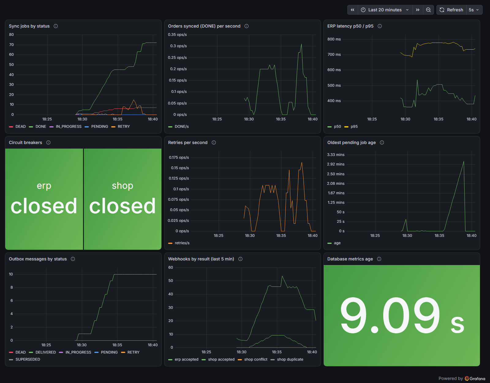
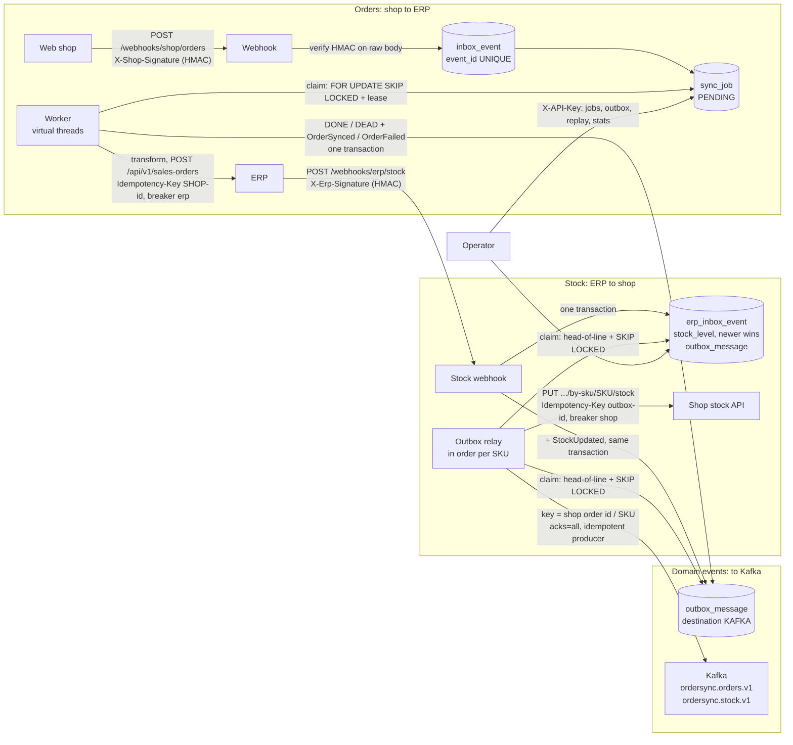
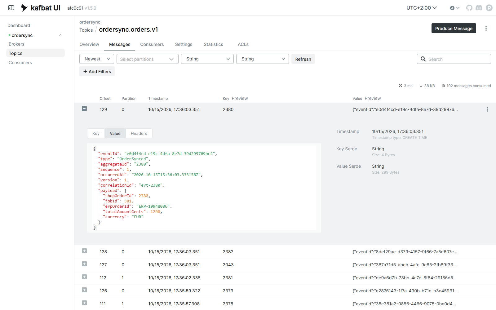
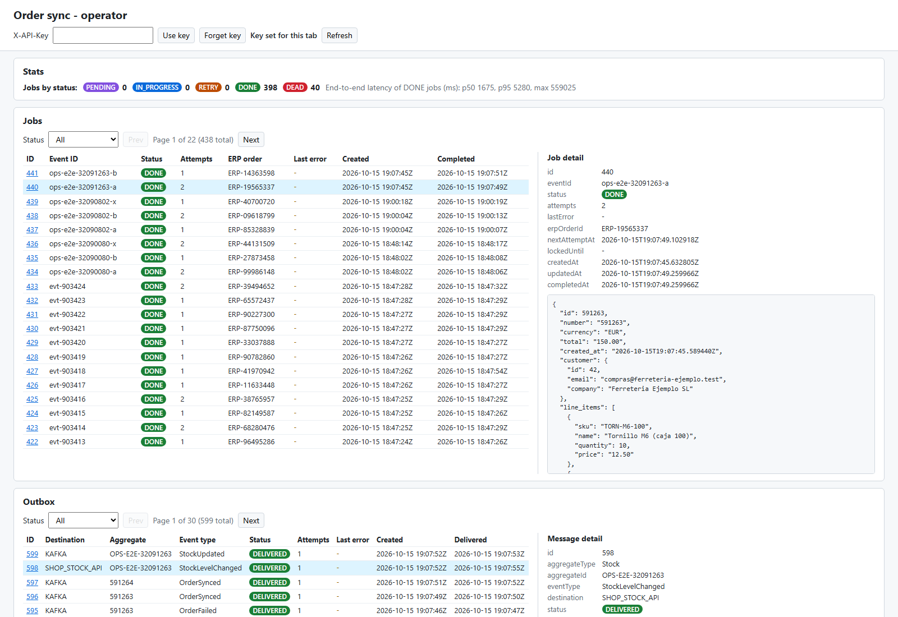

# order-sync-service

**Shop ↔ ERP integration service in Java 25 and Spring Boot 4: no order lost or duplicated, even with the ERP down**

[](https://github.com/eric-sanchezz/order-sync-service/actions/workflows/ci.yml)
[](docs/quality/20261015-h7-quality.md)
[](docs/quality/20261015-h7-quality.md)
[](build.gradle.kts)
[](build.gradle.kts)

**English** | [Español](README.es.md)

Takes orders from a B2B web shop and creates them in an ERP, and pushes the ERP's stock levels back to the shop,
without losing or duplicating anything, even when the other side is slow, down, or rejecting requests. What happened
(order synced, order failed, stock updated) is published to Kafka as domain events, through the same outbox.

In my day job I build this kind of integration (an ERP and a B2B web shop talking over REST and webhooks) with n8n.
Here it is written by hand in Java 25 and Spring Boot 4.1, so every guarantee n8n gives you (and a few it doesn't) is
explicit code with a test behind it. All data (customers, articles, orders) is invented.

## At a glance

| | |
|---|---|
| **What it is** | An integration service: orders from shop to ERP, stock from ERP to shop, domain events to Kafka |
| **Under failure** | ERP down for 60 s under 10 orders/s: **1711 of 1711 orders delivered, 0 lost, 0 duplicated** (measured before the Kafka events were added; [how it was measured](#resilience-under-failure)) |
| **Tests** | 178, of which 135 are integration tests against a real Postgres and WireMock, plus a real Kafka broker for the event tests (Testcontainers); each one was confirmed to fail when the code it guards is broken |
| **Quality gates** | 90.4% line coverage, 79 of 79 mutants killed on the pure logic (PIT), 6 architecture rules (ArchUnit), all run by CI on GitHub Actions |
| **Try it** | `docker compose up --build -d` starts everything: the service, Postgres, Kafka, Prometheus, Grafana and the mocked shop and ERP ([run it](#run-it)) |

### What it demonstrates

- **Backend in Java 25 and Spring Boot 4**: webhook endpoints verified with HMAC, an admin REST API (API key) with an
  OpenAPI spec, and a small operator page.
- **Reliable integration patterns**: idempotency (inbox table and `Idempotency-Key`), persistent retries with backoff,
  circuit breakers (Resilience4j), transactional outbox, job leases with `FOR UPDATE SKIP LOCKED`.
- **Event-driven design with Kafka**: domain events published through the outbox, in order per key, with a sequence
  number per aggregate; the at-least-once delivery is documented and was observed in a real run.
- **PostgreSQL** as the job queue, with Flyway migrations.
- **Observability**: Prometheus metrics, a provisioned Grafana dashboard, JSON logs with correlation ids, health
  checks.
- **Testing and quality**: Testcontainers integration tests, a load test with an injected ERP outage (k6), mutation
  testing, architecture rules and a CI pipeline.
- **Decisions written down**: six [architecture decision records](#design-decisions).



*The provisioned Grafana dashboard during a demo run in which Kafka was paused for 70 s; details in
[Observability](#observability).*

### Contents

[The challenge](#the-challenge) · [How it works](#how-it-works) · [Run it](#run-it) · [Try it](#try-it) ·
[Operator page](#operator-page) · [Observability](#observability) · [Resilience under failure](#resilience-under-failure) ·
[n8n vs. this code](#what-n8n-gives-you-for-free-vs-what-this-code-does) · [Testing](#testing) ·
[Quality gates](#quality-gates) · [Design decisions](#design-decisions) · [Stack](#stack) · [Author](#author)

## The challenge

The shop sends a webhook for every new order, and the ERP has its own API and data model. Between the two:

- The shop **redelivers** webhooks. The same order must not be created twice.
- The ERP **fails**: 5xx errors, timeouts, maintenance windows. Orders must wait and retry, and must survive a
  restart of this service.
- Some orders are **wrong** (unknown customer, totals that don't add up). Retrying them is pointless; someone has
  to see them and replay them once fixed.
- Formats differ: decimal strings and shop customer ids on one side, cents and ERP customer codes on the other.
- The other direction, stock from the ERP to the shop, has its own traps. Saving the new stock level and telling the
  shop are two writes that can half-fail. Updates arrive late or out of order. An old quantity must never overwrite
  a newer one in the shop.

## How it works



### Orders: shop to ERP

1. **Webhook**: checks the HMAC-SHA256 signature on the raw body bytes (constant-time compare), then the event id,
   then that the body is valid UTF-8 JSON (a leading BOM is dropped; UTF-16 and malformed bytes get a 400, and so do
   fractional quantities). The text that passed this check is exactly what gets stored. In one transaction it
   stores the event in an inbox (`event_id` is UNIQUE) and creates a `PENDING` job (the shop order id is UNIQUE
   too). It answers `202`, or `200 {"duplicate":true}` if that event was already received. The same order under a
   **new** event id never creates a second job. It is handled by the state of the existing job (ADR 0002):
   - `PENDING`/`RETRY`: the job takes the new payload (the last delivery wins). `202`
   - `DEAD`: the job takes the new payload and starts over. `202` This is how a corrected order gets through.
   - `IN_PROGRESS`: `409`, nothing stored; the shop retries later.
   - `DONE`: `200` duplicate. Updating an order that already exists in the ERP is **not** supported (out of scope).
2. **Worker**: every second it claims due jobs with `UPDATE ... FOR UPDATE SKIP LOCKED` and gives each one a 60 s
   lease. Each job then runs on its own virtual thread. The ERP call happens **outside** any transaction, and the
   result is stored with a guard (`WHERE status='IN_PROGRESS' AND locked_until = <my lease>`), so a worker that lost
   its lease cannot overwrite someone else's result. If storing the result fails for a moment (timeout, lost
   connection), the job waits for its lease to expire and is sent again with the same `Idempotency-Key`. If the
   database rejects the data itself, retrying cannot help: the job goes `DEAD` with a message telling the operator
   to check the ERP (see [ADR 0002](docs/adr/0002-idempotency-inbox-and-idempotency-key.md)).
3. **Outcome**:

   | ERP answer | Job |
   |---|---|
   | 2xx | `DONE`, with the ERP order id |
   | 408, 429, 5xx, timeout, IO error | `RETRY` with exponential backoff and jitter (2 s base, 5 min cap); `DEAD` after 5 calls |
   | other 4xx | `DEAD` at once, with `HTTP <code>: <body>` |
   | circuit breaker open | `RETRY` in 30 s, **without** using up an attempt (the ERP was never called) |
   | invalid order (unknown customer, totals don't match, missing fields...) | `DEAD` without calling the ERP |

4. **Admin API** (`X-API-Key`): list jobs by status, inspect one (last error, ERP order id, original payload),
   replay a `DEAD` job, and get stats (count per status, end-to-end p50/p95/max).

Money is `long` cents from the moment the shop's `"12.50"` is parsed (no `double`, no `BigDecimal`), with overflow
checks. The only business rule is that the sum of the lines must equal the order total.

### Stock: ERP to shop (transactional outbox)

1. **Stock webhook** (`POST /webhooks/erp/stock`, `X-Erp-Event-Id`, `X-Erp-Signature`). The ERP has its own HMAC
   secret, and the same gatekeeping applies: signature, event id, strict UTF-8 JSON. Then validation:
   `articleCode` (at most 100 characters, no control characters), `quantityAvailable >= 0` as a whole number, and
   `changedAt` as an ISO-8601 timestamp with an offset, at most 5 minutes ahead of our clock (a change stamped in
   the future would freeze the SKU).
2. **One transaction** stores the event in `erp_inbox_event` (UNIQUE event id, so a redelivery answers
   `200 {"duplicate":true}`). Next it updates `stock_level` **unless `changedAt` is older** than the stored one (an
   equal timestamp is applied: two changes in the same second must both count); an older change is answered
   `200 {"stale":true}` and changes nothing else. Then it marks older unsent messages for the
   same SKU `SUPERSEDED` (stock is an absolute value, so the newest wins) and writes the new message to
   `outbox_message`. It answers `202`. The stock level and the message are saved together or not at all.
3. **Outbox relay**: same mechanics as the order worker (lease, SKIP LOCKED, virtual threads, guarded result,
   persistent retries with backoff, circuit breaker `shop`, attempt budget). Two additions:
   - **In order per SKU**: a message is only claimed when no older message for the same SKU is still pending or in
     flight. A newer quantity can never reach the shop before an older one. Other SKUs are not held up.
   - **Stale check before sending**: if a newer message for the same SKU exists (a `DEAD` message replayed after a
     newer one was delivered), it is marked `SUPERSEDED` and not sent.
4. **Admin API**: `GET /admin/outbox?status=`, `GET /admin/outbox/{id}`, `POST /admin/outbox/{id}/replay`
   (only `DEAD`, otherwise 409).

### Domain events: to Kafka (through the outbox)

Three events, each written to `outbox_message` (destination `KAFKA`) **in the same transaction** as the change it
reports, and published by the same relay. Kafka is never called inside a business transaction, so there is no dual
write: no `DONE` without its event, no event for a change that was rolled back
([ADR 0006](docs/adr/0006-domain-events-to-kafka-via-outbox.md)).

| Event | Written when | Topic | Key |
|---|---|---|---|
| `OrderSynced` | a job reaches `DONE` | `ordersync.orders.v1` | shop order id |
| `OrderFailed` | a job reaches `DEAD` (every path: ERP rejection, attempts used up, invalid order...) | `ordersync.orders.v1` | shop order id |
| `StockUpdated` | an ERP stock change is applied (not stale, not a duplicate) | `ordersync.stock.v1` | article code (SKU) |

- **Format** (JSON, version 1; fields are only ever added, a breaking change means a `.v2` topic): `eventId` (UUID),
  `type`, `aggregateId` (= the key), `sequence`, `occurredAt` (when the change was committed, UTC), `version`,
  `correlationId` (the webhook event id that started it) and `payload`. Headers: `eventId`, `eventType`,
  `correlationId`.
- **`sequence`**: 1, 2, 3... per aggregate (per order, per SKU), taken in the same transaction as the event from a
  per-aggregate counter whose row lock makes a second writer wait. It follows the order in which the changes were
  committed, which is also the order in which they are published.
- **What a consumer must do**: deduplicate by `eventId`, and for each aggregate keep the highest `sequence` seen and
  drop any event with a lower or equal one. Both cases happen: an event can arrive twice (below), and a replayed event
  keeps its `sequence`.
- **Order per key**: the record key is the shop order id or the SKU, so all events of one order or one SKU land in
  the same partition; the relay only publishes an event once the older ones of its key are out (head-of-line, as for
  the shop). `StockUpdated` is never `SUPERSEDED`: events are history, not state, so both of two quick changes are
  published while the shop only gets the newest quantity.
- **At least once**: the producer uses `acks=all` and idempotence, so the broker drops the producer's own retries.
  But if the acknowledgement is lost, the relay sends the event again, and a consumer can see it twice. This happens:
  in a real run with Kafka paused for 97 s (`docker compose pause kafka`), one `OrderSynced` was stored twice, at
  consecutive offsets, with the same `eventId` and `sequence`.
- **Kafka down**: nothing goes `DEAD`. Failures that can heal (broker away, timeouts, not enough replicas) are
  retried with backoff (2 s doubling up to a 5 min cap) for as long as it takes, and once the `kafka` circuit breaker
  opens, the refused calls do not even count as attempts. In that same run, the event failed 6 times, the breaker
  opened, and it was published 57 s after Kafka came back (its next retry was due then). Meanwhile it shows up as lag
  (`ordersync_events_outbox_oldest_age_seconds`), never as a `DEAD` message.
- **`DEAD` blocks its key**: only an event Kafka can never take (too large, not serializable, invalid topic, not
  authorized) goes `DEAD`. Unlike the shop's messages, a `DEAD` event holds back every newer event of its key, so a
  consumer can never see an older fact after a newer one (a key is one order or one SKU: order 1001 and a SKU "1001"
  do not block each other). The key stays blocked until the event is replayed (`POST /admin/outbox/{id}/replay`) once
  the cause is fixed; `lastError` in `GET /admin/outbox/{id}` names the cause Kafka gave (e.g.
  `RecordTooLargeException: The message is 456 bytes ...`). If a key has several `DEAD` events, replay the oldest
  first: a newer one waits behind it anyway. `ordersync_events_blocked_keys` counts the blocked keys.
- **Alerts worth setting**: `ordersync_events_blocked_keys > 0` for 5 minutes (someone has to look and replay);
  `ordersync_events_outbox_oldest_age_seconds` above a few minutes (Kafka unreachable or slow); the `kafka` breaker
  not `closed` (`resilience4j_circuitbreaker_state{name="kafka",state="closed"} == 0`).
- `EVENTS_KAFKA_ENABLED=false` stops writing events (and creating topics); events already in the outbox are still
  published.

## Run it

You need Docker. One command starts Postgres, the service, a WireMock "unstable ERP" (port 8089), a WireMock shop
stock API (port 8090, always answers 200), Kafka (KRaft, one node, port 9092), kafka-ui (port 8085), Prometheus
(port 9090) and Grafana (port 3000):

```bash
docker compose up --build -d
```

The ERP mock cycles through `503, 201, 201` with 50-800 ms of latency on each call. WireMock cannot return random
5xx, so the failures follow a fixed cycle rather than real randomness.

## Try it

On a fresh stack (`docker compose down -v` first if it has already run; the job ids below assume an empty database):

```bash
# A valid order (customer 42). The first ERP call gets a 503, so the job goes through RETRY before DONE.
./scripts/send-order.sh scripts/sample-order.json demo-1
# -> {"jobId":1,"status":"PENDING"}  HTTP 202

# The same event again: no new job.
./scripts/send-order.sh scripts/sample-order.json demo-1
# -> {"jobId":1,"duplicate":true}  HTTP 200

# A customer the ERP doesn't know: DEAD without calling the ERP.
./scripts/send-order.sh scripts/sample-order-unknown-customer.json demo-2

# A few seconds later:
curl -s -H "X-API-Key: dev-admin-key" localhost:8080/admin/jobs
curl -s -H "X-API-Key: dev-admin-key" localhost:8080/admin/jobs/1
curl -s -H "X-API-Key: dev-admin-key" localhost:8080/admin/stats

# What the ERP actually received (note the Idempotency-Key header):
curl -s localhost:8089/__admin/requests

# Replay a DEAD job once the cause is fixed (409 if the job is not DEAD):
curl -s -X POST -H "X-API-Key: dev-admin-key" localhost:8080/admin/jobs/2/replay
```

Stock, from the ERP to the shop:

```bash
./scripts/send-stock-update.sh scripts/sample-stock-update.json stock-1
# -> {"outboxId":4,"status":"PENDING"}  HTTP 202
# (the id depends on how many order events the outbox already holds: 4 if you ran the commands above in order)

# The same event id again: 200 {"duplicate":true}. A change older than the stored one: 200 {"stale":true}
# (edit changedAt in a copy of the file to an earlier time to see it). An equal changedAt is applied again.
./scripts/send-stock-update.sh scripts/sample-stock-update.json stock-1

# The outbox holds the shop's stock message and the Kafka events (destination KAFKA):
curl -s -H "X-API-Key: dev-admin-key" localhost:8080/admin/outbox
# What the shop received (Idempotency-Key: outbox-<that id>, Authorization: Bearer ...):
curl -s localhost:8090/__admin/requests
```

The events, as a consumer sees them (or open kafka-ui at <http://localhost:8085>). In Git Bash, prefix the command
with `MSYS_NO_PATHCONV=1` so that `/opt/...` is not rewritten as a Windows path:

```bash
docker compose exec kafka /opt/kafka/bin/kafka-console-consumer.sh --bootstrap-server localhost:9092 \
  --topic ordersync.orders.v1 --from-beginning --timeout-ms 5000 \
  --formatter-property print.key=true --formatter-property print.headers=true
```

The `OrderSynced` of `demo-1`, copied from a real run (headers, key, value):

```
eventId:919e9f03-a30e-47c8-8a17-4e344a7dfb40,eventType:OrderSynced,correlationId:demo-1	1001	{"eventId":"919e9f03-a30e-47c8-8a17-4e344a7dfb40","type":"OrderSynced","aggregateId":"1001","sequence":1,"occurredAt":"2026-10-15T13:21:39.837474Z","version":1,"correlationId":"demo-1","payload":{"shopOrderId":1001,"jobId":1,"erpOrderId":"ERP-44329070","totalAmountCents":15000,"currency":"EUR"}}
```

The same run also had two `OrderFailed` for order 1002 (`demo-2` going `DEAD`, with `sequence` 1, then again after
its replay, with `sequence` 2) and, on `ordersync.stock.v1`, the `StockUpdated` of `stock-1` with key
`TORN-M6-100`.



*kafka-ui during the demo traffic of the Grafana capture below: records keyed by shop order id, spread over the
topic's partitions, and one `OrderSynced` opened with its envelope and payload.*

Both scripts sign the file with `openssl dgst -sha256 -hmac` and send exactly those bytes with
`curl --data-binary`. API docs: <http://localhost:8080/swagger-ui.html>.

The `dev-*` secrets in `docker-compose.yml` are demo values. Configuration comes from environment variables:

| Variable | Default | Meaning |
|---|---|---|
| `SHOP_WEBHOOK_SECRET` | (required) | HMAC secret shared with the shop |
| `ADMIN_API_KEY` | (required) | Key for `/admin/**` |
| `ERP_BASE_URL` | `http://localhost:8089` | ERP API |
| `ERP_TIMEOUT` | `5s` | Connect and read timeout per call |
| `RETRY_MAX_ATTEMPTS` | `5` | ERP calls before giving up |
| `RETRY_BASE_DELAY` / `RETRY_MAX_DELAY` | `2s` / `5m` | Backoff base and cap |
| `RETRY_JITTER` | `true` | Randomize each delay within `[d/2, d]` |
| `CIRCUIT_OPEN_DELAY` | `30s` | When to look again at a job the breaker refused |
| `CB_WAIT_OPEN` | `30s` | How long the breaker stays open |
| `WORKER_ENABLED`, `WORKER_POLL_INTERVAL`, `WORKER_BATCH_SIZE` | `true`, `1s`, `20` | Worker |
| `ERP_WEBHOOK_SECRET` | (required) | HMAC secret of the ERP's stock webhook |
| `SHOP_BASE_URL` | `http://localhost:8090` | Shop stock API |
| `SHOP_API_TOKEN` | (required) | Bearer token for the shop API |
| `SHOP_TIMEOUT` | `5s` | Connect and read timeout per shop call |
| `OUTBOX_RELAY_ENABLED`, `OUTBOX_POLL_INTERVAL`, `OUTBOX_BATCH_SIZE` | `true`, `1s`, `20` | Outbox relay |
| `STOCK_MAX_CLOCK_SKEW` | `5m` | How far ahead of our clock a stock change may be stamped |
| `MANAGEMENT_PORT` | `8081` | Actuator port (health, Prometheus scrape) |
| `METRICS_DB_REFRESH_INTERVAL`, `METRICS_DB_QUERY_TIMEOUT` | `15s`, `2s` | Background refresh of the database gauges |
| `LOGGING_STRUCTURED_FORMAT_CONSOLE` | (plain text) | `ecs` for JSON logs (set in docker-compose) |
| `KAFKA_BOOTSTRAP_SERVERS` | `localhost:9092` | Kafka brokers (`kafka:29092` in docker-compose) |
| `EVENTS_KAFKA_ENABLED` | `true` | Write domain events to the outbox (and create the topics at startup) |
| `EVENTS_KAFKA_SEND_TIMEOUT` | `15s` | How long one publish waits for Kafka's acknowledgement |

Retries, backoff and `CB_WAIT_OPEN` apply to both directions. The service refuses to start if a secret, the API key
or the shop token is blank.

## Operator page

A small page for whoever runs the service: <http://localhost:8080/ops/index.html>. Type the admin key in the
X-API-Key field (`dev-admin-key` in the demo) and press **Use key**. From there you can:

- see the job counts per status and the end-to-end latency of `DONE` jobs (the same figures as `/admin/stats`);
- list jobs and outbox messages, filtered by status, 20 per page, and open one to see every field and its payload;
- replay a `DEAD` job or message, after a confirmation. The page then reloads it and shows its real state; if it was
  no longer `DEAD` (another operator replayed it first, say), the API's 409 is shown as a message.



*Job 440 went `DEAD` while the ERP answered 422. Once the cause was removed it was replayed from this page, and it is
now `DONE` with its ERP order id. Below, the outbox with both destinations.*

Security:

- The page is static and public, like the API docs: it holds no data. The data only comes from `/admin/**` with the
  key, which the page sends in the `X-API-Key` header. The key is kept in the tab's `sessionStorage` (gone when the
  tab is closed; **Forget key** clears it at once), never in the URL or in the page.
- Only `/ops/**` is opened, with its own strict Content-Security-Policy: its own script and styles only, no inline
  code, no framing. Everything that comes from the API is written with `textContent`, so an order with HTML in it
  (say, a company called ``) is shown as text and never runs.
- It uses only the existing admin API: the job list has no shop order id (it is in the payload), and the outbox is
  filtered by status only. No cookies, so no CSRF; same origin, so no CORS.

## Observability

Open <http://localhost:3000> (anonymous read-only access). The provisioned dashboard **order-sync-service** shows:
jobs by status, orders synced per second, ERP latency p50/p95, retries per second, the state of the `erp`, `shop`
and `kafka` circuit breakers, the age of the oldest pending job, outbox messages by status, webhooks by result, how fresh the
database numbers are, and the Kafka events: published and failed per second, how many are waiting in the outbox and
the age of the oldest one (the publishing lag), and the keys blocked by a `DEAD` event.

The capture at the [top of this page](#at-a-glance) is that dashboard. *A real run of about 12 minutes: about 350 orders and 65 stock updates. About 1 order in 10 went to a customer the
ERP doesn't know and ended `DEAD` on purpose (some came back later with the customer fixed and reached `DONE`); 2
more ended `DEAD` because the stateful ERP mock answers 404 "not matched" to concurrent calls, a limitation of the
mock itself. Around 17:31 Kafka was paused for 70 s (`docker compose pause kafka`): publishing stopped, up to about
57 events waited in the outbox and the publishing lag reached almost 2 minutes. Once Kafka was back, the backlog went
out in a burst and no event ended `DEAD`.*

- **Metrics** (Micrometer, scraped by Prometheus every 5 s):
  - `ordersync_jobs{status}`, `ordersync_outbox_messages{status}` and `ordersync_jobs_oldest_pending_age_seconds`
    are gauges read **from Postgres**. The queue lives there, so they are exact, survive restarts, and agree across
    instances. They are refreshed in the background every 15 s, with one query on a separate connection and a 2 s
    timeout, so a scrape never touches the database and stays fast even while it is down.
    `ordersync_db_snapshot_age_seconds` says how old those numbers are. Same for the Kafka events not yet
    published: `ordersync_events_outbox_pending`, `ordersync_events_outbox_oldest_age_seconds` and
    `ordersync_events_blocked_keys`.
  - Counters and timers: `ordersync_erp_requests_seconds{outcome}` and `ordersync_shop_requests_seconds{outcome}`
    (with histograms for percentiles), `ordersync_jobs_retries_total`, `ordersync_jobs_dead_total`,
    `ordersync_webhook_received_total{source,result}`, `ordersync_events_published_total{type}` and
    `ordersync_events_failed_total{type,outcome}`.
  - `resilience4j_circuitbreaker_state{name,state}` for the three breakers (`erp`, `shop`, `kafka`).
- **Health**: the `erp` and `shop` components report the state of their circuit breaker. Any state other than
  `CLOSED` is `DEGRADED`, which still answers 200. An ERP outage is not an outage of this service, which keeps
  accepting and queueing work. Liveness (used by the Docker healthcheck) only checks that the process answers, so a
  dead ERP never gets the container restarted. Readiness checks the database.
- **Where**: the actuator is on its own **management port, 8081**. It only serves `/actuator/health/**` and
  `/actuator/prometheus`, and docker-compose does not publish it: Prometheus reaches it inside the compose network.
  The application port (8080) has no actuator at all. In production the same split keeps metrics and health off the
  public interface.
- **Logs**: in docker-compose they are JSON (Spring Boot's built-in ECS format). Each line carries the correlation
  fields of what it is about: `eventId` in the webhooks, `eventId` and `jobId` in the worker, `outboxId` and
  `aggregateId` in the relay. `docker compose logs app` shows them; locally and in tests the logs stay plain text.

See [ADR 0005](docs/adr/0005-observability.md) for the reasoning.

## Resilience under failure

A load test with an ERP outage in the middle. k6 posts 10 signed orders per second for 180 s (every 20th request
redelivers an earlier event instead). 60 s after the first request, a WireMock stub makes the ERP answer 503 to every
order for 60 s. The script then waits until the queue is empty and checks each order against the data (k6's output,
the `sync_job` table and the ERP mock's request journal, not the app's counters):

- **Lost**: the webhook answered 202, but the ERP never answered a 2xx to the order's `Idempotency-Key`, whatever
  the job says, or the order has no job.
- **Duplicated**: more than one job for the order, more than one 2xx from the ERP for its key, a key in the ERP that
  matches no order sent, or the same key sent with different payloads.

A run only counts if the outage shows in the journal (at least 5 ERP 503s while the stub was in, none outside it)
and caused retries or refused calls; otherwise the script marks it INVALID.

I ran it 3 times with the outage and once without it (baseline), all with the same load. All 4 had 0 lost,
0 duplicated and 0 `DEAD`. The table shows the worst outage run (the highest end-to-end p95, the criterion fixed
before running) next to the baseline. Raw data:
[outage](docs/results/20261013T215214Z-resilience/) and [baseline](docs/results/20261013T220039Z-resilience/); every
run and the method are in [docs/results](docs/results/README.md).

| Figure | ERP down 60 s (worst of 3) | Baseline, no outage |
|---|---|---|
| Orders sent by k6 / accepted (202) | 1711 / 1711 | 1711 / 1711 |
| **Lost** | **0** | **0** |
| **Duplicated** | **0** | **0** |
| ... orders with more than one job | 0 | 0 |
| ... keys the ERP answered 2xx more than once | 0 | 0 |
| ... ERP keys matching no order sent | 0 | 0 |
| ... keys sent with different payloads | 0 | 0 |
| Jobs `DEAD` | 0 | 0 |
| Requests to the ERP / per accepted order | 1732 / 1.013 | 1711 / 1 |
| ... answered 503 | 21 | 0 |
| Calls the circuit breaker refused (never sent; app metric) | 1158 | 0 |
| Most ERP calls used by one order | 2 (of 5 allowed) | 1 |
| Ingest latency p95 / max (webhook -> 202, k6) | 6 ms / 35.6 ms | 6.3 ms / 94.8 ms |
| End to end p50 / p95 / max (accepted -> `DONE`) | 46598 / 86498 / 119786 ms | 1332 / 2202 / 2558 ms |
| k6 failed requests / checks passed | 0% / 100% | 0% / 100% |

What the figures say:
- The outage cost 21 real calls to the ERP. After a few 503s the breaker opened and refused 1158 calls without
  sending them and without using up the orders' attempts; every 10 s it let one test call through. So no order
  ran out of attempts and none ended `DEAD`.
- The webhook kept answering 202 in a few milliseconds throughout: the shop never noticed the outage.
- End-to-end latency is the honest cost: a p95 of 86 s against 2.2 s without the outage. No order is created in
  the ERP during the outage, and afterwards one instance drains about 11 orders/s while 10/s keep arriving: with the
  default settings the worker sends a batch of 20 calls in parallel, waits for the slowest one (up to 800 ms) and
  polls again 1 s later, so 20 / 1.8 s. The queue was empty about 107 s after the ERP came back (`run.log`).
- The mock's outage is clean 503s. A timeout after the ERP has already created the order is the case the
  `Idempotency-Key` exists for, and this mock does not simulate it.

Environment: Windows 11 Home with Docker Desktop 4.95 (16 CPUs), one instance of the app, k6 v2.3.0
(`grafana/k6:2.3.0`), WireMock 3.13.1. For the run, the app uses `CB_WAIT_OPEN=10s` and `CIRCUIT_OPEN_DELAY=5s`
(30 s by default) so the queue recovers within a three-minute test; everything else is the default configuration.
The ERP mock answers 201 after 50-800 ms through a dedicated stub, because WireMock's stateful `503, 201, 201`
scenario of the demo answers 404 to concurrent calls. The script removes its stubs at the end, so the demo behaves as
in "Try it" again. The runs were made before the Kafka events existed (H6): the stack had no Kafka then, and
`docker compose up` now also starts it.

To reproduce (tested on Windows 11 with Git Bash and Docker Desktop; needs Docker and curl):

```bash
docker compose up --build -d
./scripts/resilience-run.sh                     # about 5 minutes; writes docs/results/<UTC timestamp>-resilience/
CHAOS_DURATION=0 ./scripts/resilience-run.sh    # the baseline: same load, no outage
```

k6 lives in the compose profile `load`, so a plain `docker compose up` never starts the load.

## What n8n gives you for free vs. what this code does

| Concern | In n8n | Here |
|---|---|---|
| Receiving the webhook | Webhook node | `POST /webhooks/shop/orders`, HMAC checked on the raw bytes before anything is parsed |
| Not processing a redelivery twice | Usually nothing; you add a lookup by hand | Inbox table with a UNIQUE `event_id`, plus a UNIQUE shop order id on the job (the same order under a new event id), both with `ON CONFLICT DO NOTHING` |
| Not creating the ERP order twice after a timeout | Nothing | `Idempotency-Key: SHOP-<order id>`, derived from the order rather than the delivery |
| Retries | "Retry on fail" per node, in memory, lost if the instance restarts | Retry state lives in Postgres (`next_attempt_at`), so it survives restarts; exponential backoff with jitter |
| ERP down for a while | Every execution keeps hitting it | Circuit breaker (Resilience4j); refused calls don't use up attempts |
| Crash halfway through | Execution marked as failed (if it was recorded at all) | Lease on every claimed job; an expired lease makes the job claimable again and counts as an attempt, so a job that keeps crashing its worker still ends `DEAD` |
| Several workers | Queue mode with Redis | `FOR UPDATE SKIP LOCKED` in Postgres, no extra infrastructure |
| Failed orders | Error workflow / execution list | `DEAD` jobs with the reason, admin API to inspect and replay |
| Field mapping | Set / Code nodes | A pure, unit-tested transformer; money in `long` cents with overflow checks |
| Save a change and notify another system | Two nodes in a row: if the second fails, the first has already happened | Transactional outbox: the stock level and the message to the shop are stored in one transaction, then a relay delivers them with retries |
| Seeing what is going on | Execution list per workflow | Prometheus metrics from the database (queue by status, oldest pending job), latency histograms, circuit breaker state, a provisioned Grafana dashboard, JSON logs with correlation ids |
| Updates arriving out of order | The last execution wins, even if its data is older | `changedAt` compared on arrival and again before sending; delivery in order per SKU; older unsent messages `SUPERSEDED` |
| Telling other systems what happened | A Kafka node at the end of the workflow: if it fails after the ERP call, the event is lost (or the workflow is re-run and the ERP called again) | Domain events written to the outbox in the same transaction as the state change, published to Kafka with retries until Kafka takes them, keyed per order / SKU so each keeps its order; at least once, with an `eventId` to deduplicate and a per-aggregate `sequence` to drop stale ones |

## Testing

`./gradlew build` runs the whole suite. The integration tests start the real app against a real Postgres and the same
WireMock image as docker-compose (once as the ERP, once as the shop), all through Testcontainers. Nothing is mocked inside the app; the tests check
what can be observed from outside: HTTP responses, rows in the database, and the requests in WireMock's journal.

| Scenario | Checked |
|---|---|
| Valid webhook | 202; the ERP receives the exact expected JSON with `Idempotency-Key: SHOP-1001` and the event id as correlation id; job `DONE` with ERP order id |
| Same order under a new event id, job waiting for a retry | 202; same job, new payload sent to the ERP, attempts kept |
| Same order under a new event id, job `DEAD` (corrected customer) | 202; job back to `PENDING` with 0 attempts; reaches the ERP |
| Same order under a new event id, job in flight | 409, nothing stored; the same event retried later is accepted |
| Same order under a new event id, job `DONE` | 200 duplicate; one ERP order |
| Four deliveries of one order while it is being stored | all get the same job; no 500 |
| Bad or missing signature (incl. one extra space in the body) | 401, nothing stored, no ERP call |
| Signed but unusable (unreadable JSON, UTF-16 or malformed UTF-8, fractional quantity, no event id, event id > 200 chars) | 400, nothing stored |
| UTF-8 body with a BOM | accepted and `DONE` |
| Same event twice | 202 then 200, one job, one ERP call |
| ERP 503 then 201 | `DONE` after 2 attempts |
| ERP 422, then replay | `DEAD` after 1 attempt; replay -> `DONE`; second replay -> 409 |
| ERP always 503 | `DEAD` after exactly 5 calls |
| Unknown customer | `DEAD`, no ERP call |
| Job stuck `IN_PROGRESS` with an expired lease | claimed again and `DONE`; on its last attempt, `DEAD` without another ERP call |
| ERP order id of any length | stored, `DONE` on the first call |
| Result rejected by the database as data | `DEAD` after one ERP call, never re-sent |
| Result write cancelled by a transient error | not `DEAD`; picked up again when the lease expires |
| Circuit breaker forced open | `RETRY` with 0 attempts and no ERP call; `DONE` after it closes |
| Two workers at once, with the oldest jobs row-locked by another transaction | every order reaches the ERP exactly once |
| Admin API without key / wrong key / right key | 401 / 401 / 200 |
| Operator page (`/ops/**`) without a key | 200, with a CSP that allows no inline code or framing; the served HTML, JS and CSS hold no key, no inline script or `on*=` handler, no `innerHTML`; `/opsx/...`, `/index.html` and `/static/ops/...` still 401 |
| Valid stock webhook | 202; the shop receives the PUT with `stock_quantity`, `Idempotency-Key` and bearer token; message `DELIVERED`; `stock_level` updated |
| Stock webhook with a bad or missing signature, or the shop's | 401, nothing stored |
| Stock update signed but unusable (unreadable, missing field, negative or fractional quantity, `changedAt` without offset, as a number or more than 5 minutes in the future, code > 100 chars, control characters, missing or > 200-char event id) | 400, nothing stored |
| Same stock event twice | one PUT |
| Two changes of one SKU before the relay runs | the first is `SUPERSEDED` at once; one PUT, with the new quantity |
| Change older than the stored one | 200 stale; no PUT; stock unchanged |
| Second change stamped with the same second | applied: 202, stock and shop get the second quantity |
| Change stamped 4 / 6 minutes ahead (tolerance 5) | 202 / 400 |
| Shop 503 then 200 / shop 400 then replay | `DELIVERED` after 2 attempts / `DEAD`, then `DELIVERED`; second replay -> 409 |
| Writing the outbox message fails | the whole transaction rolls back: no inbox row, no stock change |
| Replay of an old `DEAD` message after a newer one was delivered (also with the same `changedAt`) | `SUPERSEDED`; the old quantity is not sent |
| Newer message of a SKU while an older one is in flight | waits; another SKU goes through; the old one, once retried, is `SUPERSEDED` |
| Outbox admin API | filter by status; unknown status 400; unknown id 404 |
| A job reaches DONE | the ERP success timer goes up by exactly 1 (measured before/after); `ordersync_jobs{status="DONE"}` is 1 |
| A job pending for 120 s | the oldest-pending-age gauge is at least 120 |
| Database not answering (table locked by another transaction) | the scrape still answers in under 1 s with the last values; the snapshot age grows, and goes back down afterwards |
| A webhook with a bad signature | `ordersync_webhook_received_total{source="shop",result="unauthorized"}` goes up by 1 |
| A breaker forced open | its `resilience4j_circuitbreaker_state` series reports it; health component `DEGRADED`, overall 200, liveness `UP` |
| Management port | health and prometheus 200; any other actuator path 401; on the application port, `/actuator/*` is 401 |
| Correlation ids | worker and webhook log lines carry `eventId` / `jobId` from the MDC |
| Order synced (real Kafka broker, read back with a plain consumer) | `OrderSynced` on `ordersync.orders.v1`, key = shop order id, headers `eventId`/`eventType`/`correlationId`, envelope and payload as documented |
| ERP 422 | `OrderFailed` with the `HTTP 422` reason and 1 attempt |
| Two changes of one SKU before the relay runs | both `StockUpdated` published, in order; the shop gets 1 PUT, the newest |
| Two events of one key | after one relay pass the older is published and the newer still `PENDING`; on the topic, same partition, older offset first |
| Kafka paused while an event is sent | the event goes `RETRY` (nothing lost), and is published once Kafka is back, by the same producer |
| Kafka paused for longer than the attempt budget while an order fails, the order then corrected | the failed event is never `DEAD`; it is published first and `OrderSynced` last, matching the order's real state |
| `kafka` breaker forced open | the event is postponed with 0 attempts used; published after the breaker closes |
| A `DEAD` event, then a newer event of the same order | the newer one stays `PENDING` and the blocked-keys gauge is 1; after the replay, `OrderFailed` (sequence 1) is published before `OrderSynced` (sequence 2), and the gauge is back to 0 |
| A `DEAD` event of order 1001, then a stock change of the SKU "1001" | the SKU's event is published (different key); with both `DEAD`, the blocked-keys gauge is 2 |
| Kafka rejects the event (record larger than `max.request.size`) | `DEAD` at the first attempt; `last_error` names `RecordTooLargeException`, not the client's "Send failed" wrapper |
| Four transactions write an event of one SKU at the same moment | sequences 1, 2, 3, 4 in outbox (publication) order |
| Writing the event fails | the `DONE` is rolled back with it (job still `IN_PROGRESS`, no event); once fixed, `DONE` and its event are stored together |
| A worker's lease expires while the ERP answers slowly, and another worker takes the job | one `DONE`, one `OrderSynced`: the late result is discarded and writes no second event |

Pure logic (money parsing, the order transformer, backoff, HMAC) has plain unit tests. Every test has a comment
naming the code change that would make it fail, and each of those changes was made by hand to confirm the test
really does fail.

The operator page's JavaScript has no tests in CI (there is no browser in the build). It was checked with an
end-to-end pass in Playwright (Python) against the docker-compose stack, kept outside the repository: wrong key and
no key, stats against the API, filters, details, a replay to `DONE`, the 409 when the job changed meanwhile, an
outbox replay, an order with HTML in it, Forget key, and no CSP violation in the console.

## Quality gates

Three checks on top of the tests, with figures from a local run on 2026-10-15
([report](docs/quality/20261015-h7-quality.md), with the raw JaCoCo CSV and PIT XML next to it; the
[first report](docs/quality/20261014-quality.md) explains the method and the mutants found):

- **Architecture rules** (ArchUnit, part of `./gradlew build`; all 6 pass):
  - the order mapping (`transform`) is plain Java: no Spring, JPA, `java.net`, queue or ERP-client code in it;
  - controllers never touch the database: no repositories, and no JDBC, JPA or `DataSource` either;
  - no dependency cycles between packages;
  - money is `long` cents: no `double`, `float`, `BigDecimal` or `NumberFormat` where orders are read, mapped,
    sent to the ERP or published as events (fields, signatures, generics and calls are checked). Not visible to the rule: a local `double`
    that goes through no call, and floating point hidden inside some other library's `String` to `long` method;
  - no field injection (`@Autowired`, `@Value`, `@Inject` or `@Resource` on fields) and no sleeping thread
    (`Thread.sleep`, `TimeUnit.sleep`, `LockSupport.park*`) in production code.

  Each rule was broken once by hand to confirm that it fails.
- **Coverage** (JaCoCo, the whole suite including the integration tests, no exclusions): 90.44% of lines
  (1212 of 1340) and 82.30% of branches (279 of 339). Two runs of the same code can differ by about two lines,
  because two timing-dependent paths in the metrics code are not always run. `./gradlew build` fails below 90% of
  lines (the measured value rounded down to the ten).
- **Mutation testing** (PIT, on the pure logic: money parsing, the order transformer, backoff, HMAC; against their
  unit tests): 79 of 79 mutants killed, 100%. The first run killed 66 of 79 (83.5%). Every survivor pointed at a
  missing test (for example, no unit test reached six of the order validations, and a cap that is not a multiple
  of the backoff delay was rounded up), and those tests were added. `./gradlew pitest` fails below 95%. It is not
  part of `build`; the CI workflow runs it as a separate job.

```bash
./gradlew clean build pitest
# reports: build/reports/jacoco/test/html/index.html, build/reports/pitest/index.html
```

## Design decisions

- [ADR 0001: Postgres as the job queue (SKIP LOCKED)](docs/adr/0001-postgres-queue-skip-locked.md)
- [ADR 0002: Idempotency with an inbox and an Idempotency-Key](docs/adr/0002-idempotency-inbox-and-idempotency-key.md)
- [ADR 0003: Persistent retries vs. in-memory, and the circuit breaker](docs/adr/0003-persistent-retries-vs-in-memory-and-circuit-breaker.md)
- [ADR 0004: Transactional outbox for the stock sync](docs/adr/0004-transactional-outbox-for-stock-sync.md)
- [ADR 0005: Observability](docs/adr/0005-observability.md)
- [ADR 0006: Domain events to Kafka through the outbox](docs/adr/0006-domain-events-to-kafka-via-outbox.md)

## Stack

Java 25, Spring Boot 4.1 (Web MVC, Data JPA + JdbcClient, Security, Validation, Actuator), PostgreSQL 17 with Flyway,
Resilience4j, Apache Kafka (Spring for Apache Kafka), Micrometer + Prometheus + Grafana, springdoc-openapi, JUnit 6, AssertJ, Testcontainers, WireMock,
Awaitility, ArchUnit, JaCoCo, PIT. Gradle (Kotlin DSL).

## Author

Eric Sánchez, backend and integrations developer (Java, Kotlin, Python, SQL). [LinkedIn](https://www.linkedin.com/in/ericsanchezdev/) ·
[GitHub](https://github.com/eric-sanchezz).
