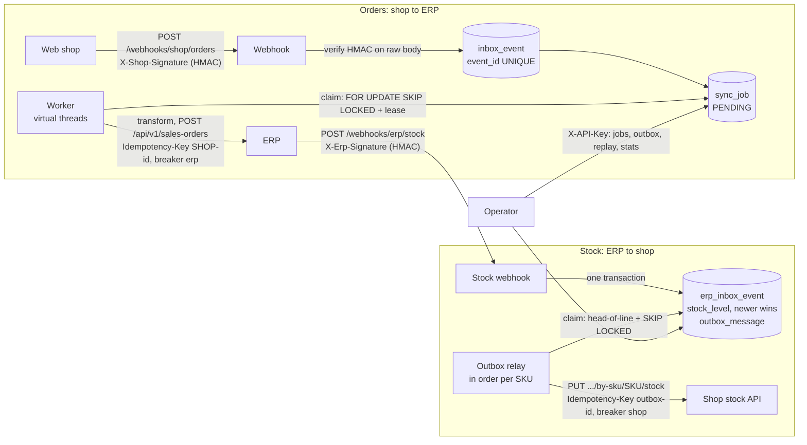

# order-sync-service

Takes orders from a B2B web shop and creates them in an ERP, and pushes the ERP's stock levels back to the shop,
without losing or duplicating anything, even when the other side is slow, down, or rejecting requests.

This is the kind of integration I usually build with n8n. Here it is written by hand in Java 25 and Spring Boot 4.1,
so every guarantee n8n gives you (and a few it doesn't) is explicit code with a test behind it. All data
(customers, articles, orders) is invented.

## The problem

The shop sends a webhook for every new order, and the ERP has its own API and data model. Between the two:

- The shop **redelivers** webhooks. The same order must not be created twice.
- The ERP **fails**: 5xx errors, timeouts, maintenance windows. Orders must wait and retry, and must survive a
  restart of this service.
- Some orders are **wrong** (unknown customer, totals that don't add up). Retrying them is pointless; someone has
  to see them and replay them once fixed.
- Formats differ: decimal strings and shop customer ids on one side, cents and ERP customer codes on the other.
- The other direction, stock from the ERP to the shop, has its own traps. Saving the new stock level and telling the
  shop are two writes that can half-fail. Updates arrive late or out of order. An old quantity must never overwrite
  a newer one in the shop.

## How it works



### Orders: shop to ERP

1. **Webhook**: checks the HMAC-SHA256 signature on the raw body bytes (constant-time compare), then the event id,
   then that the body is valid UTF-8 JSON (a leading BOM is dropped; UTF-16 and malformed bytes get a 400, and so do
   fractional quantities). The text that passed this check is exactly what gets stored. In one transaction it
   stores the event in an inbox (`event_id` is UNIQUE) and creates a `PENDING` job (the shop order id is UNIQUE
   too). It answers `202`, or `200 {"duplicate":true}` if that event was already received. The same order under a
   **new** event id never creates a second job. It is handled by the state of the existing job (ADR 0002):
   - `PENDING`/`RETRY`: the job takes the new payload (the last delivery wins). `202`
   - `DEAD`: the job takes the new payload and starts over. `202` This is how a corrected order gets through.
   - `IN_PROGRESS`: `409`, nothing stored; the shop retries later.
   - `DONE`: `200` duplicate. Updating an order that already exists in the ERP is **not** supported (out of scope).
2. **Worker**: every second it claims due jobs with `UPDATE ... FOR UPDATE SKIP LOCKED` and gives each one a 60 s
   lease. Each job then runs on its own virtual thread. The ERP call happens **outside** any transaction, and the
   result is stored with a guard (`WHERE status='IN_PROGRESS' AND locked_until = <my lease>`), so a worker that lost
   its lease cannot overwrite someone else's result. If storing the result fails for a moment (timeout, lost
   connection), the job waits for its lease to expire and is sent again with the same `Idempotency-Key`. If the
   database rejects the data itself, retrying cannot help: the job goes `DEAD` with a message telling the operator
   to check the ERP (see [ADR 0002](docs/adr/0002-idempotency-inbox-and-idempotency-key.md)).
3. **Outcome**:

   | ERP answer | Job |
   |---|---|
   | 2xx | `DONE`, with the ERP order id |
   | 408, 429, 5xx, timeout, IO error | `RETRY` with exponential backoff and jitter (2 s base, 5 min cap); `DEAD` after 5 calls |
   | other 4xx | `DEAD` at once, with `HTTP <code>: <body>` |
   | circuit breaker open | `RETRY` in 30 s, **without** using up an attempt (the ERP was never called) |
   | invalid order (unknown customer, totals don't match, missing fields...) | `DEAD` without calling the ERP |

4. **Admin API** (`X-API-Key`): list jobs by status, inspect one (last error, ERP order id, original payload),
   replay a `DEAD` job, and get stats (count per status, end-to-end p50/p95/max).

Money is `long` cents from the moment the shop's `"12.50"` is parsed (no `double`, no `BigDecimal`), with overflow
checks. The only business rule is that the sum of the lines must equal the order total.

### Stock: ERP to shop (transactional outbox)

1. **Stock webhook** (`POST /webhooks/erp/stock`, `X-Erp-Event-Id`, `X-Erp-Signature`). The ERP has its own HMAC
   secret, and the same gatekeeping applies: signature, event id, strict UTF-8 JSON. Then validation:
   `articleCode` (at most 100 characters, no control characters), `quantityAvailable >= 0` as a whole number, and
   `changedAt` as an ISO-8601 timestamp with an offset, at most 5 minutes ahead of our clock (a change stamped in
   the future would freeze the SKU).
2. **One transaction** stores the event in `erp_inbox_event` (UNIQUE event id, so a redelivery answers
   `200 {"duplicate":true}`). Next it updates `stock_level` **unless `changedAt` is older** than the stored one (an
   equal timestamp is applied: two changes in the same second must both count); an older change is answered
   `200 {"stale":true}` and changes nothing else. Then it marks older unsent messages for the
   same SKU `SUPERSEDED` (stock is an absolute value, so the newest wins) and writes the new message to
   `outbox_message`. It answers `202`. The stock level and the message are saved together or not at all.
3. **Outbox relay**: same mechanics as the order worker (lease, SKIP LOCKED, virtual threads, guarded result,
   persistent retries with backoff, circuit breaker `shop`, attempt budget). Two additions:
   - **In order per SKU**: a message is only claimed when no older message for the same SKU is still pending or in
     flight. A newer quantity can never reach the shop before an older one. Other SKUs are not held up.
   - **Stale check before sending**: if a newer message for the same SKU exists (a `DEAD` message replayed after a
     newer one was delivered), it is marked `SUPERSEDED` and not sent.
4. **Admin API**: `GET /admin/outbox?status=`, `GET /admin/outbox/{id}`, `POST /admin/outbox/{id}/replay`
   (only `DEAD`, otherwise 409).

## Run it

You need Docker. One command starts Postgres, the service, a WireMock "unstable ERP" (port 8089) and a WireMock shop
stock API (port 8090, always answers 200):

```bash
docker compose up --build -d
```

The ERP mock cycles through `503, 201, 201` with 50-800 ms of latency on each call. WireMock cannot return random
5xx, so the failures follow a fixed cycle rather than real randomness.

## Try it

```bash
# A valid order (customer 42). The first ERP call gets a 503, so the job goes through RETRY before DONE.
./scripts/send-order.sh scripts/sample-order.json demo-1
# -> {"jobId":1,"status":"PENDING"}  HTTP 202

# The same event again: no new job.
./scripts/send-order.sh scripts/sample-order.json demo-1
# -> {"jobId":1,"duplicate":true}  HTTP 200

# A customer the ERP doesn't know: DEAD without calling the ERP.
./scripts/send-order.sh scripts/sample-order-unknown-customer.json demo-2

# A few seconds later:
curl -s -H "X-API-Key: dev-admin-key" localhost:8080/admin/jobs
curl -s -H "X-API-Key: dev-admin-key" localhost:8080/admin/jobs/1
curl -s -H "X-API-Key: dev-admin-key" localhost:8080/admin/stats

# What the ERP actually received (note the Idempotency-Key header):
curl -s localhost:8089/__admin/requests

# Replay a DEAD job once the cause is fixed (409 if the job is not DEAD):
curl -s -X POST -H "X-API-Key: dev-admin-key" localhost:8080/admin/jobs/2/replay
```

Stock, from the ERP to the shop:

```bash
./scripts/send-stock-update.sh scripts/sample-stock-update.json stock-1
# -> {"outboxId":1,"status":"PENDING"}  HTTP 202

# The same event id again: 200 {"duplicate":true}. A change older than the stored one: 200 {"stale":true}
# (edit changedAt in a copy of the file to an earlier time to see it). An equal changedAt is applied again.
./scripts/send-stock-update.sh scripts/sample-stock-update.json stock-1

curl -s -H "X-API-Key: dev-admin-key" localhost:8080/admin/outbox
# What the shop received (Idempotency-Key: outbox-1, Authorization: Bearer ...):
curl -s localhost:8090/__admin/requests
```

Both scripts sign the file with `openssl dgst -sha256 -hmac` and send exactly those bytes with
`curl --data-binary`. API docs: <http://localhost:8080/swagger-ui.html>.

The `dev-*` secrets in `docker-compose.yml` are demo values. Configuration comes from environment variables:

| Variable | Default | Meaning |
|---|---|---|
| `SHOP_WEBHOOK_SECRET` | (required) | HMAC secret shared with the shop |
| `ADMIN_API_KEY` | (required) | Key for `/admin/**` |
| `ERP_BASE_URL` | `http://localhost:8089` | ERP API |
| `ERP_TIMEOUT` | `5s` | Connect and read timeout per call |
| `RETRY_MAX_ATTEMPTS` | `5` | ERP calls before giving up |
| `RETRY_BASE_DELAY` / `RETRY_MAX_DELAY` | `2s` / `5m` | Backoff base and cap |
| `RETRY_JITTER` | `true` | Randomize each delay within `[d/2, d]` |
| `CIRCUIT_OPEN_DELAY` | `30s` | When to look again at a job the breaker refused |
| `CB_WAIT_OPEN` | `30s` | How long the breaker stays open |
| `WORKER_ENABLED`, `WORKER_POLL_INTERVAL`, `WORKER_BATCH_SIZE` | `true`, `1s`, `20` | Worker |
| `ERP_WEBHOOK_SECRET` | (required) | HMAC secret of the ERP's stock webhook |
| `SHOP_BASE_URL` | `http://localhost:8090` | Shop stock API |
| `SHOP_API_TOKEN` | (required) | Bearer token for the shop API |
| `SHOP_TIMEOUT` | `5s` | Connect and read timeout per shop call |
| `OUTBOX_RELAY_ENABLED`, `OUTBOX_POLL_INTERVAL`, `OUTBOX_BATCH_SIZE` | `true`, `1s`, `20` | Outbox relay |
| `STOCK_MAX_CLOCK_SKEW` | `5m` | How far ahead of our clock a stock change may be stamped |

Retries, backoff and `CB_WAIT_OPEN` apply to both directions. The service refuses to start if a secret, the API key
or the shop token is blank.

## What n8n gives you for free vs. what this code does

| Concern | In n8n | Here |
|---|---|---|
| Receiving the webhook | Webhook node | `POST /webhooks/shop/orders`, HMAC checked on the raw bytes before anything is parsed |
| Not processing a redelivery twice | Usually nothing; you add a lookup by hand | Inbox table with a UNIQUE `event_id`, plus a UNIQUE shop order id on the job (the same order under a new event id), both with `ON CONFLICT DO NOTHING` |
| Not creating the ERP order twice after a timeout | Nothing | `Idempotency-Key: SHOP-<order id>`, derived from the order rather than the delivery |
| Retries | "Retry on fail" per node, in memory, lost if the instance restarts | Retry state lives in Postgres (`next_attempt_at`), so it survives restarts; exponential backoff with jitter |
| ERP down for a while | Every execution keeps hitting it | Circuit breaker (Resilience4j); refused calls don't use up attempts |
| Crash halfway through | Execution marked as failed (if it was recorded at all) | Lease on every claimed job; an expired lease makes the job claimable again and counts as an attempt, so a job that keeps crashing its worker still ends `DEAD` |
| Several workers | Queue mode with Redis | `FOR UPDATE SKIP LOCKED` in Postgres, no extra infrastructure |
| Failed orders | Error workflow / execution list | `DEAD` jobs with the reason, admin API to inspect and replay |
| Field mapping | Set / Code nodes | A pure, unit-tested transformer; money in `long` cents with overflow checks |
| Save a change and notify another system | Two nodes in a row: if the second fails, the first has already happened | Transactional outbox: the stock level and the message to the shop are stored in one transaction, then a relay delivers them with retries |
| Updates arriving out of order | The last execution wins, even if its data is older | `changedAt` compared on arrival and again before sending; delivery in order per SKU; older unsent messages `SUPERSEDED` |

## Testing

`./gradlew build` runs the whole suite. The integration tests start the real app against a real Postgres and the same
WireMock image as docker-compose (once as the ERP, once as the shop), all through Testcontainers. Nothing is mocked inside the app; the tests check
what can be observed from outside: HTTP responses, rows in the database, and the requests in WireMock's journal.

| Scenario | Checked |
|---|---|
| Valid webhook | 202; the ERP receives the exact expected JSON with `Idempotency-Key: SHOP-1001` and the event id as correlation id; job `DONE` with ERP order id |
| Same order under a new event id, job waiting for a retry | 202; same job, new payload sent to the ERP, attempts kept |
| Same order under a new event id, job `DEAD` (corrected customer) | 202; job back to `PENDING` with 0 attempts; reaches the ERP |
| Same order under a new event id, job in flight | 409, nothing stored; the same event retried later is accepted |
| Same order under a new event id, job `DONE` | 200 duplicate; one ERP order |
| Four deliveries of one order while it is being stored | all get the same job; no 500 |
| Bad or missing signature (incl. one extra space in the body) | 401, nothing stored, no ERP call |
| Signed but unusable (unreadable JSON, UTF-16 or malformed UTF-8, fractional quantity, no event id, event id > 200 chars) | 400, nothing stored |
| UTF-8 body with a BOM | accepted and `DONE` |
| Same event twice | 202 then 200, one job, one ERP call |
| ERP 503 then 201 | `DONE` after 2 attempts |
| ERP 422, then replay | `DEAD` after 1 attempt; replay -> `DONE`; second replay -> 409 |
| ERP always 503 | `DEAD` after exactly 5 calls |
| Unknown customer | `DEAD`, no ERP call |
| Job stuck `IN_PROGRESS` with an expired lease | claimed again and `DONE`; on its last attempt, `DEAD` without another ERP call |
| ERP order id of any length | stored, `DONE` on the first call |
| Result rejected by the database as data | `DEAD` after one ERP call, never re-sent |
| Result write cancelled by a transient error | not `DEAD`; picked up again when the lease expires |
| Circuit breaker forced open | `RETRY` with 0 attempts and no ERP call; `DONE` after it closes |
| Two workers at once, with the oldest jobs row-locked by another transaction | every order reaches the ERP exactly once |
| Admin API without key / wrong key / right key | 401 / 401 / 200 |
| Valid stock webhook | 202; the shop receives the PUT with `stock_quantity`, `Idempotency-Key` and bearer token; message `DELIVERED`; `stock_level` updated |
| Stock webhook with a bad or missing signature, or the shop's | 401, nothing stored |
| Stock update signed but unusable (unreadable, missing field, negative or fractional quantity, `changedAt` without offset, as a number or more than 5 minutes in the future, code > 100 chars, control characters, missing or > 200-char event id) | 400, nothing stored |
| Same stock event twice | one PUT |
| Two changes of one SKU before the relay runs | the first is `SUPERSEDED` at once; one PUT, with the new quantity |
| Change older than the stored one | 200 stale; no PUT; stock unchanged |
| Second change stamped with the same second | applied: 202, stock and shop get the second quantity |
| Change stamped 4 / 6 minutes ahead (tolerance 5) | 202 / 400 |
| Shop 503 then 200 / shop 400 then replay | `DELIVERED` after 2 attempts / `DEAD`, then `DELIVERED`; second replay -> 409 |
| Writing the outbox message fails | the whole transaction rolls back: no inbox row, no stock change |
| Replay of an old `DEAD` message after a newer one was delivered (also with the same `changedAt`) | `SUPERSEDED`; the old quantity is not sent |
| Newer message of a SKU while an older one is in flight | waits; another SKU goes through; the old one, once retried, is `SUPERSEDED` |
| Outbox admin API | filter by status; unknown status 400; unknown id 404 |

Pure logic (money parsing, the order transformer, backoff, HMAC) has plain unit tests. Every test has a comment
naming the code change that would make it fail, and each of those changes was made by hand to confirm the test
really does fail.

## Design decisions

- [ADR 0001: Postgres as the job queue (SKIP LOCKED)](docs/adr/0001-postgres-queue-skip-locked.md)
- [ADR 0002: Idempotency with an inbox and an Idempotency-Key](docs/adr/0002-idempotency-inbox-and-idempotency-key.md)
- [ADR 0003: Persistent retries vs. in-memory, and the circuit breaker](docs/adr/0003-persistent-retries-vs-in-memory-and-circuit-breaker.md)
- [ADR 0004: Transactional outbox for the stock sync](docs/adr/0004-transactional-outbox-for-stock-sync.md)

## Stack

Java 25, Spring Boot 4.1 (Web MVC, Data JPA + JdbcClient, Security, Validation, Actuator), PostgreSQL 17 with Flyway,
Resilience4j, springdoc-openapi, JUnit 5, AssertJ, Testcontainers, WireMock, Awaitility. Gradle (Kotlin DSL).
